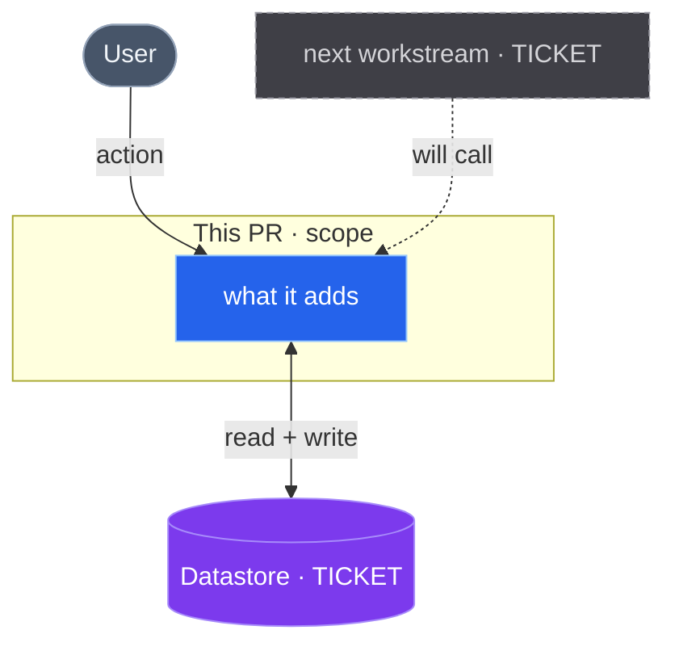
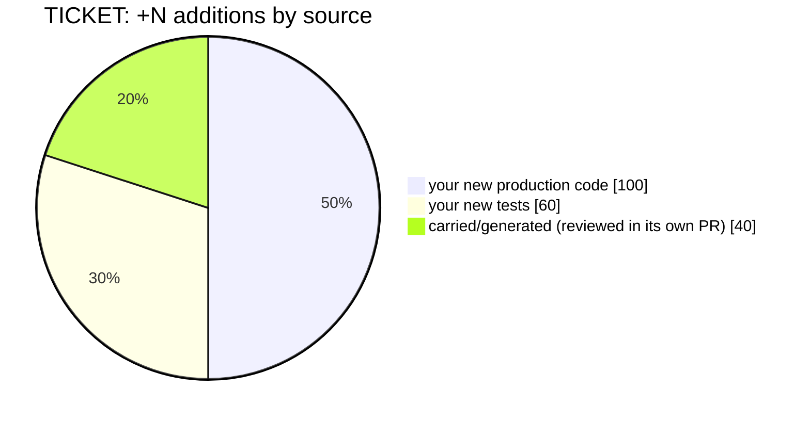

# PR Body Template

The body opens with `## At a glance`, which holds two mermaid diagrams. Then a short narrative
summary, a one-line TL;DR, and one collapsed `<details>` block holding every piece of evidence.
These replace a host template's `## What` placeholder. Keep the host's own `## Type` and
`## Checklist` sections, inside the `<details>`.

## The skeleton

````markdown
## At a glance

<flowchart, then the additions-by-source pie>

## What this does

<plain words for a non-engineer>

## Why it's useful

<plain words>

## What's next

<plain words>

> ⚠️ Blocked: <one line. ONLY if actively blocked; omit otherwise>

**TL;DR:** <one line, the bottom of the visible summary>

<details>
<summary>Evidence &amp; review detail</summary>

## Safety / Constraints

- <Sandbox/non-prod only, no production access, no live dual writes, no secrets.>

## What's Here

- `<path/>`: <surface and responsibility>

## Tests / Validation

- <Hermetic suite and count; docker/local, live/sandbox, parity/idempotency proofs>

## Acceptance Criteria

<Only with a PRD. One row per criterion, every ID accounted for. Counts on the last line.
Never fabricate IDs to fill it.>

| ID | Status | Evidence |
|---|---|---|
| A1 | PASS | <file, log line, record id, or screenshot> |
| A4 | NOT RUN | <why, and what would unblock it> |

## Evidence

- <Counts, sample sizes, run outcomes, drift/parity summaries, evidence file paths>

## Review Dispositions

| Finding | Disposition |
|---|---|
| <summary> | FIXED / REJECTED / DEFERRED with proof or reason |

## Decisions Touched

<Only when the work changes or depends on a PRD Locked Decision. Cite by ID.>

| ID | How this PR relates to it |
|---|---|
| D5 | <implements, relies on, or would contradict; and what that means for review> |

## Stacking / Merge Order

- Base: `<branch>` · Depends on: <PR/branch> · Retarget after: <condition>

## Remaining Blockers / Follow-up

- <Only real blockers or explicitly deferred work>

</details>
````

## The visible summary: under 250 words

Check `wc -w` across all narrative sections combined, not per section. The diagrams and the
`<details>` block do not count. Only the narrative, the TL;DR, and the blocker line do.

A reviewer skims this in about fifteen seconds. Use two to five short sections. Plain words for
a non-engineer: short sentences, concrete nouns, no jargon, no paths, no filler ("in order to",
"this PR aims to"), no hype. Not dumbed down.

- Good: "Adds a way for managers to see which orders shipped late, so they can fix the slow steps."
- Slop: "This PR aims to implement comprehensive functionality to enhance fulfillment observability."

End with a single `**TL;DR:**` line.

**Never bury a blocker.** If the PR must not merge, surface one visible line right above the
TL;DR. That line counts toward the 250. The full blocker list still collapses.

Everything structured lives inside the one `<details>`. It is exempt from the word budget and
must still be complete and honest. Never leave long prose, tables, or dumps in the visible body.

## Flowchart: where this PR sits

Fixed: `flowchart TB`, vertical. GitHub scales every mermaid diagram to container width, so a
horizontal `LR` chart shrinks to a clipped strip. A vertical chart fits width by growing taller.

Shapes carry role: actor `([…])`, work nodes `[…]` inside one `subgraph PR["This PR · …"]`,
datastores as cylinders `[("… · TICKET")]`. Edges: `-->` one-way, `<-->` read and write, `-.->`
not yet built. Label edges with a verb or endpoint, keep labels short with `<br/>`, six nodes
maximum.

Color by role so it reads on GitHub light and dark: actor slate `#475569`, datastore purple
`#7C3AED`, this-PR work blue `#2563EB`, output teal `#0D9488`, not-yet-built muted dashed
`#3F3F46`.

Per PR: ids, labels, and node counts match the real shape. Omit roles the PR lacks. Add an
upstream node only if it calls one. Placeholders inside mermaid render blank, so write real text.



## Pie: honest authorship by source

Bucket the added lines. Carried, generated, or vendored code is always its own slice. Then your
tests against your production code. Split by ticket only when one slice would otherwise
dominate. Three to five slices. Never fold a carried slice into your own.

```bash
git diff --numstat "origin/$(gh pr view --json baseRefName -q .baseRefName 2>/dev/null||echo main)...HEAD"
```


