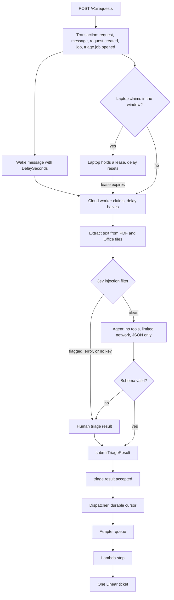

# pw-customer-support

A drop-in React support widget sends customer requests to a PressW backend. The backend triages each request into a Linear ticket and carries the reply thread back to the customer.

The product requirements and phased plan live in [docs/plans/customer-support-v1](docs/plans/customer-support-v1/PRD.md).

## Quick start

Install Bun 1.3, Docker, and set `GITHUB_TOKEN` to a token with `read:packages`. The `.npmrc` file uses it to install `@pressw-llc/*` packages.

```bash
bun install
bun run env sync
bun run stack:up
bun run stack:setup
bun run db:migrate
bun run check
```

The stack runs Postgres on `127.0.0.1:5447`, LocalStack on `127.0.0.1:4577`, and a mock OIDC issuer on `127.0.0.1:4599`. `bun run env sync` creates `.env.local` from `.env.example`. Every script still runs on built-in defaults against the local stack without it. `bun run stack:up` and `bun run stack:down` pass the ports from `.env.local` to Docker Compose.

## Environment

`.env.example` is the committed template. Put real values in `.env.local`, which is gitignored. Manage both files with `bun run env` and the `env-files` skill. Do not edit them by hand. `bun run env set` writes a blank to `.env.example` for a key whose name contains `KEY`, `SECRET`, `TOKEN`, `PASSWORD`, `PRIVATE`, or `CREDENTIAL`, and for any value read from `--stdin`. Pass `--not-secret` to publish a dummy value, as with the LocalStack credentials.

| Variable                                     | Default                                | Purpose                                        |
| -------------------------------------------- | -------------------------------------- | ---------------------------------------------- |
| `SUPPORT_POSTGRES_PORT`                      | `5447`                                 | Host port for Postgres                         |
| `SUPPORT_LOCALSTACK_PORT`                    | `4577`                                 | Host port for LocalStack                       |
| `DATABASE_URL`                               | derived from `SUPPORT_POSTGRES_PORT`   | Optional override of the Postgres URL          |
| `AWS_REGION`                                 | `us-east-1`                            | AWS region for the SDK clients                 |
| `AWS_ENDPOINT_URL`                           | derived from `SUPPORT_LOCALSTACK_PORT` | Optional override of the AWS endpoint          |
| `AWS_ACCESS_KEY_ID`, `AWS_SECRET_ACCESS_KEY` | `test`                                 | Local credentials for LocalStack               |
| `ATTACHMENTS_BUCKET`                         | `pw-support-attachments`               | S3 bucket for attachments                      |
| `TRIAGE_WAKE_QUEUE`                          | `pw-support-triage-wake`               | SQS queue that wakes triage                    |
| `TRIAGE_WAKE_DLQ`                            | `pw-support-triage-wake-dlq`           | Dead-letter queue for the wake queue           |
| `API_PORT`                                   | `8787`                                 | Port for the Hono API server                   |
| `ANTHROPIC_API_KEY`                          | blank, secret                          | Anthropic API key                              |
| `TYPESAFE_API_KEY`                           | blank, secret                          | TypeSafe key for the Jev filter                |
| `LINEAR_API_KEY`                             | blank, secret                          | Linear API key                                 |
| `LINEAR_WEBHOOK_SECRET`                      | blank, secret                          | Linear webhook signing secret                  |
| `COGNITO_ISSUER`                             | blank, mock issuer locally             | Token issuer URL. Production fails closed      |
| `COGNITO_AUDIENCE`                           | blank, `pw-support-admin` locally      | Comma list of accepted client ids              |
| `SUPPORT_OIDC_PORT`                          | `4599`                                 | Host port for the mock OIDC issuer             |
| `ADMIN_DEV_PORT`                             | `5183`                                 | Port for the admin Vite dev server             |
| `ADMIN_ORIGINS`                              | blank, local admin origins             | Origins that admin CORS allows                 |
| `ADMIN_ALLOWED_EMAIL_DOMAINS`                | blank, off                             | Comma list of allowed staff email domains      |
| `ADMIN_REQUIRED_GROUP`                       | blank, off                             | Cognito group a staff token must carry         |
| `ADMIN_MAX_BODY_BYTES`                       | `16384`                                | Body cap for admin requests                    |
| `ADMIN_RATE_LIMIT_PER_WINDOW`                | `60`                                   | Admin mutations per window per staff member    |
| `AUTH_FETCH_TIMEOUT_MS`                      | `5000`                                 | Timeout for issuer discovery and JWKS fetches  |
| `SECRETS_SCOPE`                              | `global`                               | Scope segment in the Secrets Manager name      |
| `VITE_API_URL`                               | blank, local API                       | Admin app API base URL                         |
| `VITE_OIDC_AUTHORITY`                        | blank, mock issuer                     | Admin app OIDC issuer URL                      |
| `VITE_OIDC_CLIENT_ID`                        | blank, `pw-support-admin`              | Admin app OIDC client id                       |
| `VITE_OIDC_SCOPE`                            | blank, `openid profile email`          | Admin app OIDC scopes                          |
| `VALIDATE_API_PORT`                          | `8796`                                 | API port for `validate:phase-4`                |
| `E2E_ADMIN_PORT`                             | `5184`                                 | Admin app port for the e2e suite               |
| `NODE_ENV`                                   | unset                                  | `production` turns off the LocalStack defaults |
| `RATE_LIMIT_WINDOW_SECONDS`                  | `60`                                   | Rate limit window length                       |
| `RATE_LIMIT_PER_KEY`                         | `600`                                  | Requests per window for one project key        |
| `RATE_LIMIT_PER_USER`                        | `120`                                  | Requests per window for one hashed ID          |
| `MAX_REQUEST_BYTES`                          | 251 MiB                                | Request body cap before a 413                  |
| `SEED_CLIENT_SLUG`                           | `acme`                                 | `seed:dev` client slug                         |
| `SEED_PROJECT_SLUG`                          | `portal`                               | `seed:dev` project slug                        |
| `SEED_PROJECT_KEY`                           | random, blank in the template          | `seed:dev` key for a new project               |
| `TRIAGE_INITIAL_DELAY_SECONDS`               | `60`                                   | Cloud delay for a new job on an idle channel   |
| `TRIAGE_LEASE_SECONDS`                       | `120`                                  | Claim lease length                             |
| `TRIAGE_MAX_ATTEMPTS`                        | `3`                                    | Cloud attempts before human triage             |
| `TRIAGE_INTAKE_GRACE_SECONDS`                | `300`                                  | Wait for attachment storage before a claim     |
| `TRIAGE_SWEEP_INTERVAL_SECONDS`              | `30`                                   | Worker sweep and dispatch interval             |
| `TRIAGE_AGENT_MODEL`                         | `claude-sonnet-5-5`                    | Model for the synced triage agent              |
| `TRIAGE_AGENT_ID`                            | blank, lock file                       | Agent id, overrides the lock file              |
| `TRIAGE_AGENT_TIMEOUT_SECONDS`               | `240`                                  | Agent session timeout                          |
| `TRIAGE_WORKER_ID`                           | random                                 | Claimant name for the cloud worker             |
| `TRIAGE_MAX_CHARS_PER_FILE`                  | `20000`                                | Extracted text cap per file                    |
| `TRIAGE_MAX_CHARS_TOTAL`                     | `60000`                                | Extracted text cap per request                 |
| `TRIAGE_MAX_IMAGES`                          | `6`                                    | Images sent to the agent                       |
| `JEV_INJECTION_THRESHOLD`                    | `0.5`                                  | Score at or above which Jev flags a request    |
| `JEV_TIMEOUT_MS`                             | `15000`                                | Jev request timeout                            |
| `JEV_CHUNK_CHARS`                            | `4000`                                 | Characters per Jev judgment                    |
| `JEV_JUDGE_IMAGES`                           | `1`                                    | Judge images with Jev. Off sends no image      |
| `LINEAR_API_URL`                             | blank, Linear API                      | Linear GraphQL URL. Ignored in production      |
| `LINEAR_TEST_TEAM_ID`                        | blank                                  | Team for the self-skipping live Linear test    |
| `LINEAR_STUB_PORT`                           | `4590`                                 | Port for `bun run dev:linear-stub`             |
| `SEED_LINEAR_TEAM_ID`                        | blank                                  | Team id for `bun run seed:settings`            |
| `VALIDATE_TIME_FACTOR`                       | `1`                                    | Scale for the delays in `validate:phase-2`     |
| `SUPPORT_API_URL`                            | `http://localhost:8787`                | Widget build-time default API URL              |
| `VITE_SUPPORT_PROJECT_KEY`                   | blank                                  | Example app project key                        |
| `VITE_SUPPORT_USER_EMAIL`                    | blank                                  | Example app signed-in email                    |
| `VITE_SUPPORT_API_URL`                       | blank, widget default                  | Example app API URL                            |

## Run the widget locally

Start the stack, seed a demo project, then start the API and the example host app in two terminals.

```bash
bun run stack:up && bun run stack:setup
bun run seed:dev
bun run dev:api
```

`seed:dev` prints the project key for `acme/portal`. It is idempotent and prints the same key on every run. Pass the key to the example app and start it.

```bash
bun run build
VITE_SUPPORT_PROJECT_KEY=<printed key> \
VITE_SUPPORT_USER_EMAIL=ada@acme.test \
VITE_SUPPORT_API_URL=http://127.0.0.1:8787 \
bun run dev:example
```

Open the printed Vite URL. The host app uses one import and two props:

```tsx
import { SupportWidget } from "@pressw-llc/support-react";

<SupportWidget projectKey="pk_..." userEmail="ada@acme.test" />;
```

Script-tag use loads `dist/support-widget.global.js` and calls `window.PressWSupport.mount(element, { projectKey, userEmail, apiUrl })`.

## Commands

| Command                         | Action                                                                    |
| ------------------------------- | ------------------------------------------------------------------------- |
| `bun run check`                 | Run install, lint, build, typecheck, stack, test, e2e, and synth in order |
| `bun run check --skip-install`  | Run the same stages without the install                                   |
| `bun run lint`                  | Run Biome and the module boundary check                                   |
| `bun run build`                 | Build the widget and the admin app into each module `dist`                |
| `bun run typecheck`             | Run `tsc --noEmit` in every module, the example app, and e2e              |
| `bun run test`                  | Run root tests, then the widget tests under happy-dom                     |
| `bun test path/to/file.test.ts` | Run one root test file                                                    |
| `bun run e2e`                   | Run the Playwright suite. It starts the API and the example app           |
| `bun run stack:up`              | Start Postgres and LocalStack                                             |
| `bun run stack:setup`           | Create the S3 bucket and SQS queues in LocalStack                         |
| `bun run stack:down`            | Stop the stack and delete its volumes                                     |
| `bun run env <command>`         | Manage `.env.example` and `.env.local` without printing values            |
| `bun run db:migrate`            | Apply the SQL migrations to `DATABASE_URL`                                |
| `bun run seed:dev`              | Create the demo project and print its project key                         |
| `bun run dev:api`               | Migrate, set up the stack, and start the API on `API_PORT`                |
| `bun run dev:example`           | Start the example host app with Vite                                      |
| `bun run dev:admin`             | Start the admin app on `ADMIN_DEV_PORT` against the local API and issuer  |
| `bun run dev:worker`            | Migrate, set up the stack, and run the triage worker and the dispatcher   |
| `bun run dev:linear-stub`       | Start the local Linear GraphQL stub                                       |
| `bun run agent:sync`            | Publish the triage agent and write its lock file                          |
| `bun run seed:settings <team>`  | Route the seed project to a Linear team                                   |
| `bun run validate:pipelines`    | Run `bunx pw-pipeline validate`                                           |
| `bun run validate:phase-2`      | Run the live Phase 2 validation against Jev and Managed Agents            |
| `bun run validate:phase-4`      | Run the live admin validation against the mock issuer and LocalStack      |
| `bun run synth`                 | Run `cdk synth` with no AWS credentials                                   |

`bun run check` leaves the stack running. Run `bun run stack:down` to stop it. The e2e stage installs Chromium when it is missing. Screenshots land in `e2e/artifacts`.

## Intake API

Every `/v1` route needs the header `X-Support-Key` with the project key and `X-Support-User` with the lowercase hex `SHA-256(email + key)`. CORS allows any origin. An unknown or revoked key returns 401.

| Route                            | Action                                                |
| -------------------------------- | ----------------------------------------------------- |
| `POST /v1/requests`              | Multipart `text` and up to 10 `files`. Returns 201    |
| `GET /v1/requests`               | List the customer's requests with previews and unread |
| `GET /v1/requests/:id`           | Read the thread. Internal messages never appear       |
| `POST /v1/requests/:id/messages` | Send a follow-up with the same checks                 |
| `POST /v1/requests/:id/read`     | Mark the thread read                                  |
| `GET /v1/attachments/:id`        | Stream a stored attachment                            |
| `GET /health`                    | Return `{ "status": "ok" }`                           |

The API commits the request, the first message, and a `request.created` event before it runs any static check. A message with markup or over 10,000 characters stays stored and gets `body_flagged`. An attachment is accepted by magic bytes, not by name. Each rejected file returns a reason: `too_many_files`, `too_large`, `empty`, `executable`, `video`, `type_not_allowed`, or `storage_failed`. Rate limits use fixed windows in Postgres per project key and per hashed ID, and return 429 with `Retry-After`.

## Triage

Every request opens one triage job in the same transaction as the request. A cloud worker claims the job after a delay, filters it, runs a sandboxed agent, and a Linear adapter creates one ticket.



### Claim protocol

One atomic `UPDATE ... RETURNING` decides the winner. A laptop may claim an open job at any time. The cloud may claim an open job after `cloud_available_at`. Either may claim a job whose lease expired. A claim sets a fresh token and a lease, and appends `triage.job.claimed`. A takeover also appends `triage.job.lease_expired`.

The delay belongs to the channel `client:project`. A new job waits the current delay. A cloud claim of a job that no laptop claimed halves the delay with integer floor: 60, 30, 15, 7, 3, 1, 0. A laptop claim resets it to 60. The halving is one conditional `UPDATE` that applies only when no reset or halving landed after the job opened, and the reset is one upsert. A burst of jobs opened in one window halves once, and a laptop reset is never overwritten.

`submitTriageResult` takes the live claim token and validates the payload with the contracts schema. A valid result completes the job. An invalid result appends `triage.result.rejected` and reopens the job for the cloud at once. Laptop and cloud claimants use the same function. The triage entrypoint exports `submitResult(deps, input)`, which wraps it and sends a wake with no delay when an invalid result reopens the job.

A job is claimable only after the API stores the attachments, or after `TRIAGE_INTAKE_GRACE_SECONDS`. This stops a worker from reading files that are not stored yet.

### Worker

`bun run dev:worker` runs `pipelines/support-triage/fargate-entries/main.ts`, the same entry a Fargate task runs. SIGTERM and SIGINT abort every loop. It runs four loops:
- The Fargate worker. It uses `@pressw-llc/pipeline` `fargateMain` with the `support-triage` pipeline and one `triage` step on `runtime: "fargate"`. The pipeline runs without a repo, so the engine writes no run rows. The job table owns all state.
- The sweeper. `runTriageWorker` starts it next to `fargateMain`. At start and on an interval it claims open jobs whose delay ended and jobs with expired leases. A job survives a stopped worker and a lost wake message.
- The dispatcher. It reads `support.events` by `seq` with one durable cursor per adapter in `support.event_cursors`. Each tick also redelivers completed jobs that have no ticket.
- The adapter poller. It reads the adapter queue and runs the `linear-outbound` Lambda handler.

On a wake the worker tries the claim first. When the claim loses, it re-sends the wake with the remaining delay when the job is not yet claimable, and with the remaining lease plus one second when a laptop holds a live lease. It drops the wake when the job is complete.

When processing fails for a transient reason, the worker releases the job in one transaction with its `triage.job.released` event and sends a fresh wake after 5, 10, then 20 seconds, capped at 60. Each claim counts as an attempt. A job past `TRIAGE_MAX_ATTEMPTS` completes as human triage with `attempts_exhausted`. A heartbeat extends the lease every third of the lease time. When the extension fails, the worker aborts and archives the agent session and stops processing that job.

The wake and adapter queues set an explicit `VisibilityTimeout`, 300 and 60 seconds, from constants in `@pw-support/contracts`. The local stack setup and the CDK stack apply the same values.

The API sends the wake message with `DelaySeconds`. The pipeline engine sends no delay of its own. The wake body is the pipeline envelope with `input.jobId`.

### Filter and agent

Deterministic code extracts text from PDF (`unpdf`), docx, xlsx, and pptx (`fflate` and XML), and plain text files. A zip file is stored and never read. Extracted text is capped per file and in total.

Office XML is scanned with linear `indexOf` scanners. Each archive entry stops at 4 MB inflated and each archive at 16 MB, and extraction stops at the per-file character cap. PDF extraction stops at 40 pages. PDF and Office extraction runs in a Bun `Worker` with a 20 second limit, so a hostile file cannot starve the lease heartbeat. A file that exceeds the limit is terminated and listed as not extracted. The worker reads an attachment from storage only when it will be extracted or sent as an image, and it processes attachments one at a time.

Jev scores the message and each text chunk with one `noul` judgment. The message subject holds the request text and every attachment filename, so nothing the agent reads goes unjudged. Chunks overlap by 12 percent, and a text of at most two chunks also gets a head and tail judgment. Jev also judges PNG and JPEG images. Jev rejects images outside a size range with `Invalid image dimensions`, for example 224 by 224 and 1920 by 1080.

The agent receives an image only when Jev recorded a judgment for it that is not flagged. A GIF, a WebP, an image Jev rejects, and every image when `JEV_JUDGE_IMAGES` is off is withheld. The filter records the withheld image as `skipped` in `support.judgments` with a reason, the agent sees it only as an attachment without extracted content, and the ticket lists it as not analyzed. Every raw judgment lands in `support.judgments`. A score at or above `JEV_INJECTION_THRESHOLD` flags the request.

A flagged request, a Jev error, a timeout, or a missing key completes the job as human triage and starts no agent session. The agent has no tools, no MCP servers, and an environment with `limited` networking and an empty allowlist. Its output must parse as JSON and pass the triage result schema. Anything else becomes human triage.

At worker start and on the first job the worker retrieves the remote agent and refuses to run a session unless it has zero tools, zero MCP servers, and zero skills. A drifted agent sends every job to human triage with `agent_definition_unsafe`, and the worker logs one error.

Run `bun run agent:sync` once to publish the agent. It writes `modules/triage/agents/support-triage/agent.lock.json`, which git ignores. `TRIAGE_AGENT_ID` overrides the lock file.

### Linear adapter

The dispatcher sends each `triage.result.accepted` event to the adapter queue. The `linear-outbound` Lambda step loads the event and runs the adapter. The adapter picks the team from the project's `linear_team_id`. A project without a team gets one `ticket.blocked` event and no ticket. Set the team with `bun run seed:settings <teamId>`.

The dispatcher advances its cursor when it enqueues an event. To recover a job whose message dead-lettered or whose Linear call kept failing, each tick re-enqueues `triage.result.accepted` events that have no ticket and whose project has a team. `support.ticket_deliveries` tracks the attempts and the last enqueue time. The wait doubles from 30 seconds to a cap of 15 minutes.

The title and the summary come from the validated result and render as inert text: markdown control characters are escaped, links and mentions are defanged, and the title is one line. The customer text appears only as a quoted block with markup stripped, mentions neutralized, and links defanged. Labels and priority map from the validated enums. A human triage ticket, or an agent result with `needs_human`, gets the `needs-human-triage` label, and an agent result keeps its summary. `support.tickets` holds one row per request, and an advisory lock stops duplicates.

The last line of the description is the marker `Support request ID: <id>`. The adapter finds an existing issue with an `endsWith` filter and then checks in code that the last line equals the exact marker, so quoted text or a summary that contains another marker never binds a request to the wrong issue.

The Linear key comes from a `SecretsProvider`. The runtime uses `createManagedSecrets`, which reads the Secrets Manager value that the admin settings saved and falls back to `LINEAR_API_KEY`.

`bun run dev:linear-stub` serves a GraphQL stub for `issueCreate`, `issueLabels`, `issueLabelCreate`, `team`, `issues`, `commentCreate`, and `issueArchive`. Set `LINEAR_API_URL` to the printed URL and `LINEAR_API_KEY` to any value. The override applies only outside production. A live test in `modules/channels` creates and archives one ticket when `LINEAR_API_KEY` and `LINEAR_TEST_TEAM_ID` are set.

### T15: Lambda steps locally

The Lambda step runs locally through an SQS poller that invokes the same `lambdaHandlerFor` handler, with the dispatcher feeding LocalStack SQS. A test in `pipelines/pipelines.test.ts` proves the path from request to ticket. LocalStack Lambda is not used, because it needs the Docker socket and the `lambda` service in Compose.

### Validation

`bun run validate:phase-2` needs `TYPESAFE_API_KEY` and `ANTHROPIC_API_KEY`. It starts the API and the worker as separate processes with the Linear stub, and prints one PASS or FAIL line per criterion. `VALIDATE_TIME_FACTOR` scales the delays and the lease. A factor of 0.14 gives an 8 second delay. Pass `--partial` to run the criteria that need no agent session when the Anthropic key is absent. The script treats an empty key as absent.

Test helpers live behind `@pw-support/channels/testing` and `@pw-support/triage/testing`. `scripts/lint-boundaries.ts` allows only the subpaths a module declares in `exports`.

The injection corpus in `modules/triage/corpus` runs against live Jev when `TYPESAFE_API_KEY` is set and skips otherwise.

## Admin

The admin app is a Vite React app with Tailwind v4, shadcn/ui, TanStack Query, and `oidc-client-ts`. It lives in `modules/admin`. Staff see the request list, a request detail page, and settings for projects, keys, and integrations.

### Login

The admin app signs staff in with the authorization code flow and PKCE. The API validates the bearer token with `jose`. It pins RS256 and checks the signature, the issuer, the expiry, the audience, and `token_use` when present. Cognito ID tokens carry `aud`. Access tokens carry `client_id`. The validator accepts either claim against `COGNITO_AUDIENCE`. Any failure, a missing setting, or a JWKS outage returns 401. `ADMIN_ALLOWED_EMAIL_DOMAINS` and `ADMIN_REQUIRED_GROUP` add optional checks. The admin app sends the ID token, so audit rows carry the staff email.

Locally, a mock OIDC issuer container (`mock-oauth2-server`) serves discovery and JWKS. The API has no bypass flag. Start the stack, then the API and the admin app, and open `http://127.0.0.1:5183`. The issuer shows a sign-in form. Enter any user name and optional claims such as `{"email":"ada@pressw.test"}`. `COGNITO_ISSUER` and `COGNITO_AUDIENCE` default to the mock issuer when `NODE_ENV` is not `production`.

```bash
bun run stack:up && bun run stack:setup
bun run dev:api
bun run dev:admin
```

In AWS, the issuer is the `pw-telemetry-platform` Cognito pool, `https://cognito-idp.<region>.amazonaws.com/<poolId>`. The pool lives in another account, so the API needs only its public JWKS. The admin app needs a new app client on that pool with the CloudFront URL plus `/auth/callback` as its callback URL. Set `COGNITO_ISSUER`, `COGNITO_AUDIENCE` (the app client id), and `ADMIN_ORIGINS` on the API. Put `VITE_API_URL`, `VITE_OIDC_AUTHORITY`, and `VITE_OIDC_CLIENT_ID` in a `config.json` file next to `index.html`, or set them at build time. The CDK stack exposes the same values through the `cognitoIssuer` and `cognitoAudience` context keys, and no real id lives in this repository. The app keeps tokens in session storage, renews silently, and starts a fresh login when renewal fails or the API returns 401.

### Admin routes

Every route sits behind the token validator. CORS allows only `ADMIN_ORIGINS`. Mutations are rate limited per staff member and capped at `ADMIN_MAX_BODY_BYTES`.

| Route                                         | Action                                                       |
| --------------------------------------------- | ------------------------------------------------------------ |
| `GET /admin/me`                               | Return the staff identity from the token                     |
| `GET /admin/requests`                         | Page requests, newest first, with filters and a cursor       |
| `GET /admin/requests/:id`                     | Return the thread, timeline, judgments, job, and reply flags |
| `GET /admin/attachments/:id`                  | Stream an attachment                                         |
| `GET /admin/projects`                         | List projects with keys and CC lists                         |
| `POST /admin/projects`                        | Create a project                                             |
| `PATCH /admin/projects/:id`                   | Edit the name or the Linear team                             |
| `PUT /admin/projects/:id/cc-list`             | Replace the severe-request CC list                           |
| `POST /admin/projects/:id/keys`               | Mint a key. The full key appears once                        |
| `POST /admin/projects/:id/keys/:keyId/revoke` | Revoke a key                                                 |
| `GET /admin/integrations`                     | Return `configured` and update metadata, never a value       |
| `PUT /admin/integrations/:kind`               | Store a secret in Secrets Manager                            |

The list filters are `projectId`, `status`, `flaggedReplies`, `needsHuman`, `limit`, and `cursor`. `needsHuman` matches a job with the `human_triage` outcome or a result with `needs_human`. `flaggedReplies` matches a request with a `reply.flagged` or `reply.held` event.

### Acknowledgement timer

`acknowledged_at` is the earliest message on the request where the author is `staff` and the origin is `linear` or the audience is `external`. One subquery in `modules/db/src/admin.ts` defines it. It stays null until staff comment. The list shows a running timer from `created_at` while it is null and the time to acknowledge afterwards. The timer turns amber at 15 minutes and red at 60 minutes. The constants `ACK_WARN_MINUTES` and `ACK_CRITICAL_MINUTES` live in `@pw-support/contracts`.

### Integration secrets

Saving a Linear API key, a Linear webhook secret, or a TypeSafe key writes the value to Secrets Manager under `pw-support/<scope>/<name>` and creates the secret when it does not exist. Postgres stores only the secret name in `support.integrations`, with `updated_at` and `updated_by`. No API response, log line, or event holds the value. The admin routes log the error name and never the request body.

`createManagedSecrets` in `@pw-support/channels` reads the value through the Postgres reference with a 30 second cache. It falls back to the matching environment variable, such as `LINEAR_API_KEY`, when no reference exists. The Linear client and the Jev client use it. The API invalidates its own cache after a save, and other processes see the change within the cache time.

### CC list

The severe-request CC list belongs to a project, in `support.projects.severe_cc_emails`. A Slack alert fires for one request, and a request belongs to one project, so a project list needs no routing rule. A global default can join later without a migration. V1 stores the list and nothing reads it.

### Validation

`bun run validate:phase-4` starts the API with the mock issuer and LocalStack and prints one PASS or FAIL line per check. It covers A19 (401 without a token, with a forged token, with a token from another issuer, and 200 with an issued token), A29, and the five A18 checks. A18b scans a real `pg_dump` taken inside the Postgres container. The Playwright suite in `e2e/admin.spec.ts` drives the login through the mock issuer and writes screenshots to `e2e/artifacts`.

## Modules

| Module              | Purpose                                   |
| ------------------- | ----------------------------------------- |
| `modules/contracts` | Shared zod schemas and types              |
| `modules/db`        | Postgres schema, migrations, event stream |
| `modules/api`       | Hono HTTP server                          |
| `modules/widget`    | React widget, `@pressw-llc/support-react` |
| `modules/admin`     | Staff admin UI                            |
| `modules/triage`    | Claim worker, Jev filter, triage agent    |
| `modules/channels`  | Adapter contract, dispatcher, Linear      |
| `modules/plugin`    | Claude Code plugin for laptop triage      |
| `modules/infra`     | AWS CDK stack                             |

`examples/host-app` is a fresh Vite React app that embeds the widget. `e2e` holds the Playwright suite. `pipelines` holds the `support-triage` and `linear-outbound` pipelines. `tests` holds cross-module criterion tests.

A module imports another module only through `@pw-support/contracts` or the other module's package name. `bun run lint` rejects deep imports.

## Git hooks

`bun install` points `core.hooksPath` at `.githooks`. The `commit-msg` hook enforces conventional commits. The `pre-push` hook runs `bun run check --skip-install`.

## CI

`.github/workflows/ci.yml` runs `bun run check`. Set the `PACKAGES_READ_TOKEN` secret when the default token cannot read the `@pressw-llc` packages.
