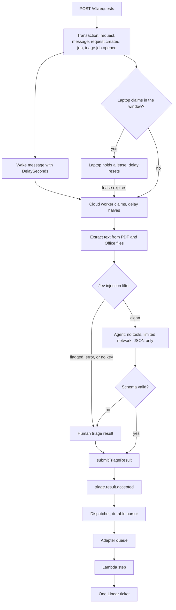
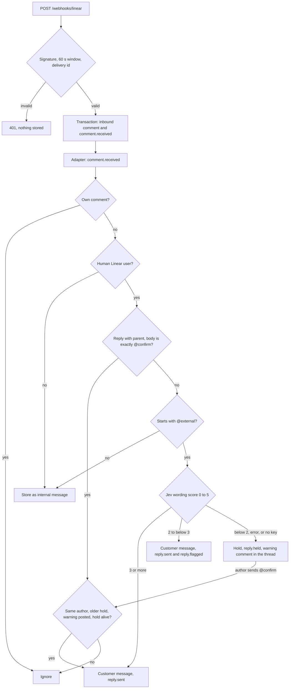
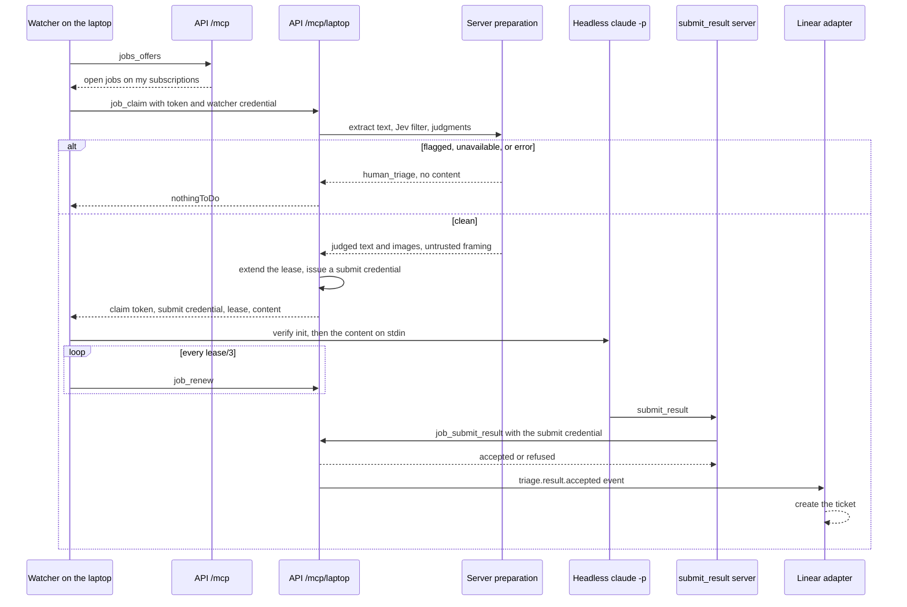

# pw-customer-support

A drop-in React support widget sends customer requests to a PressW backend. The backend triages each request into a Linear ticket and carries the reply thread back to the customer.

The product requirements and phased plan live in [docs/plans/customer-support-v1](docs/plans/customer-support-v1/PRD.md).

## Quick start

Install Bun 1.3, Docker, and set `GITHUB_TOKEN` to a token with `read:packages`. The `.npmrc` file uses it to install `@pressw-llc/*` packages.

```bash
bun install
bun run env sync
bun run stack:up
bun run stack:setup
bun run db:migrate
bun run check
```

The stack runs Postgres on `127.0.0.1:5447`, LocalStack on `127.0.0.1:4577`, and a mock OIDC issuer on `127.0.0.1:4599`. `bun run env sync` creates `.env.local` from `.env.example`. Every script still runs on built-in defaults against the local stack without it. `bun run stack:up` and `bun run stack:down` pass the ports from `.env.local` to Docker Compose.

## Environment

`.env.example` is the committed template. Put real values in `.env.local`, which is gitignored. Manage both files with `bun run env` and the `env-files` skill. Do not edit them by hand. `bun run env set` writes a blank to `.env.example` for a key whose name contains `KEY`, `SECRET`, `TOKEN`, `PASSWORD`, `PRIVATE`, or `CREDENTIAL`, and for any value read from `--stdin`. Pass `--not-secret` to publish a dummy value, as with the LocalStack credentials.

| Variable                                     | Default                                             | Purpose                                                                                           |
| -------------------------------------------- | --------------------------------------------------- | ------------------------------------------------------------------------------------------------- |
| `SUPPORT_POSTGRES_PORT`                      | `5447`                                              | Host port for Postgres                                                                            |
| `SUPPORT_LOCALSTACK_PORT`                    | `4577`                                              | Host port for LocalStack                                                                          |
| `DATABASE_URL`                               | derived from `SUPPORT_POSTGRES_PORT`                | Optional override of the Postgres URL                                                             |
| `AWS_REGION`                                 | `us-east-1`                                         | AWS region for the SDK clients                                                                    |
| `AWS_ENDPOINT_URL`                           | derived from `SUPPORT_LOCALSTACK_PORT`              | Optional override of the AWS endpoint                                                             |
| `AWS_ACCESS_KEY_ID`, `AWS_SECRET_ACCESS_KEY` | `test`                                              | Local credentials for LocalStack                                                                  |
| `ATTACHMENTS_BUCKET`                         | `pw-support-attachments`                            | S3 bucket for attachments                                                                         |
| `TRIAGE_WAKE_QUEUE`                          | `pw-support-triage-wake`                            | SQS queue that wakes triage                                                                       |
| `TRIAGE_WAKE_DLQ`                            | `pw-support-triage-wake-dlq`                        | Dead-letter queue for the wake queue                                                              |
| `API_PORT`                                   | `8787`                                              | Port for the Hono API server                                                                      |
| `ANTHROPIC_API_KEY`                          | blank, secret                                       | Anthropic API key                                                                                 |
| `TYPESAFE_API_KEY`                           | blank, secret                                       | TypeSafe key for the Jev filter                                                                   |
| `LINEAR_API_KEY`                             | blank, secret                                       | Linear API key                                                                                    |
| `LINEAR_WEBHOOK_SECRET`                      | blank, secret                                       | Linear webhook signing secret                                                                     |
| `COGNITO_ISSUER`                             | blank, mock issuer locally                          | Token issuer URL. Production fails closed                                                         |
| `COGNITO_AUDIENCE`                           | blank, `pw-support-admin` locally                   | Comma list of accepted client ids                                                                 |
| `SUPPORT_OIDC_PORT`                          | `4599`                                              | Host port for the mock OIDC issuer                                                                |
| `ADMIN_DEV_PORT`                             | `5183`                                              | Port for the admin Vite dev server                                                                |
| `ADMIN_ORIGINS`                              | blank, local admin origins                          | Origins that admin CORS allows                                                                    |
| `ADMIN_ALLOWED_EMAIL_DOMAINS`                | blank, off                                          | Comma list of allowed staff email domains                                                         |
| `ADMIN_REQUIRED_GROUP`                       | blank, off                                          | Cognito group a staff token must carry                                                            |
| `ADMIN_MAX_BODY_BYTES`                       | `16384`                                             | Body cap for admin requests                                                                       |
| `ADMIN_RATE_LIMIT_PER_WINDOW`                | `60`                                                | Admin mutations per window per staff member                                                       |
| `AUTH_FETCH_TIMEOUT_MS`                      | `5000`                                              | Timeout for issuer discovery and JWKS fetches                                                     |
| `SECRETS_SCOPE`                              | `global`                                            | Scope segment in the Secrets Manager name                                                         |
| `VITE_API_URL`                               | blank, local API                                    | Admin app API base URL                                                                            |
| `VITE_OIDC_AUTHORITY`                        | blank, mock issuer                                  | Admin app OIDC issuer URL                                                                         |
| `VITE_OIDC_CLIENT_ID`                        | blank, `pw-support-admin`                           | Admin app OIDC client id                                                                          |
| `VITE_OIDC_SCOPE`                            | blank, `openid profile email`                       | Admin app OIDC scopes                                                                             |
| `VITE_OIDC_LOGOUT_URL`                       | blank                                               | Admin app IdP logout URL template, used when discovery has no `end_session_endpoint`              |
| `VALIDATE_API_PORT`                          | free port at run time                               | API port for `validate:phase-4`. The policy API uses the next port                                |
| `E2E_ADMIN_PORT`                             | free port at run time                               | Admin app port for the e2e suite. Other `E2E_*_PORT` variables work the same way                  |
| `NODE_ENV`                                   | unset                                               | `production` turns off the LocalStack defaults                                                    |
| `RATE_LIMIT_WINDOW_SECONDS`                  | `60`                                                | Rate limit window length                                                                          |
| `RATE_LIMIT_PER_KEY`                         | `600`                                               | Requests per window for one project key                                                           |
| `RATE_LIMIT_PER_USER`                        | `120`                                               | Requests per window for one hashed ID                                                             |
| `MAX_REQUEST_BYTES`                          | 251 MiB                                             | Request body cap before a 413                                                                     |
| `SEED_CLIENT_SLUG`                           | `acme`                                              | `seed:dev` client slug                                                                            |
| `SEED_PROJECT_SLUG`                          | `portal`                                            | `seed:dev` project slug                                                                           |
| `SEED_PROJECT_KEY`                           | random, blank in the template                       | `seed:dev` key for a new project                                                                  |
| `TRIAGE_INITIAL_DELAY_SECONDS`               | `60`                                                | Cloud delay for a new job on an idle channel                                                      |
| `TRIAGE_LEASE_SECONDS`                       | `120`                                               | Claim lease length                                                                                |
| `TRIAGE_MAX_ATTEMPTS`                        | `3`                                                 | Cloud attempts before human triage                                                                |
| `TRIAGE_INTAKE_GRACE_SECONDS`                | `300`                                               | Wait for attachment storage before a claim                                                        |
| `TRIAGE_SWEEP_INTERVAL_SECONDS`              | `30`                                                | Worker sweep and dispatch interval                                                                |
| `TRIAGE_AGENT_MODEL`                         | `claude-sonnet-5-5`                                 | Model for the synced triage agent                                                                 |
| `TRIAGE_AGENT_ID`                            | blank, lock file                                    | Agent id, overrides the lock file                                                                 |
| `TRIAGE_AGENT_TIMEOUT_SECONDS`               | `240`                                               | Agent session timeout                                                                             |
| `TRIAGE_WORKER_ID`                           | random                                              | Claimant name for the cloud worker                                                                |
| `TRIAGE_MAX_CHARS_PER_FILE`                  | `20000`                                             | Extracted text cap per file                                                                       |
| `TRIAGE_MAX_CHARS_TOTAL`                     | `60000`                                             | Extracted text cap per request                                                                    |
| `TRIAGE_MAX_IMAGES`                          | `6`                                                 | Images sent to the agent                                                                          |
| `JEV_INJECTION_THRESHOLD`                    | `0.5`                                               | Score at or above which Jev flags a request                                                       |
| `JEV_TIMEOUT_MS`                             | `15000`                                             | Jev request timeout                                                                               |
| `JEV_CHUNK_CHARS`                            | `4000`                                              | Characters per Jev judgment                                                                       |
| `JEV_JUDGE_IMAGES`                           | `1`                                                 | Judge images with Jev. Off sends no image                                                         |
| `LINEAR_API_URL`                             | blank, Linear API                                   | Linear GraphQL URL. Ignored in production                                                         |
| `LINEAR_TEST_TEAM_ID`                        | blank                                               | Team for the self-skipping live Linear test                                                       |
| `LINEAR_STUB_PORT`                           | `4590`                                              | Port for `bun run dev:linear-stub`                                                                |
| `SEED_LINEAR_TEAM_ID`                        | blank                                               | Team id for `bun run seed:settings`                                                               |
| `VALIDATE_TIME_FACTOR`                       | `1`                                                 | Scale for the delays in `validate:phase-2`                                                        |
| `MCP_AUDIENCE`                               | blank, `COGNITO_AUDIENCE` plus the local MCP client | Comma list of client ids the MCP routes accept. Required in production, no fallback               |
| `MCP_REQUIRED_GROUP`                         | blank, off                                          | Cognito group an `/mcp` token must carry. Required in production. Never applies to `/admin`       |
| `MCP_RATE_LIMIT_PER_WINDOW`                  | `120`                                               | MCP tool calls per window per engineer. Pings and `tools/list` do not count                       |
| `MCP_MAX_BODY_BYTES`                         | `262144`                                            | Body cap for MCP requests                                                                         |
| `PW_SUPPORT_API_URL`                         | `http://127.0.0.1:8787`                             | Laptop plugin API base URL                                                                        |
| `PW_SUPPORT_ISSUER`                          | blank, mock issuer                                  | Laptop plugin token issuer URL                                                                    |
| `PW_SUPPORT_CLIENT_ID`                       | `pw-support-mcp`                                    | Laptop plugin OAuth client id                                                                     |
| `PW_SUPPORT_CONFIG_DIR`                      | blank, `~/.config/pw-support`                       | Token file and watcher state directory                                                            |
| `PW_SUPPORT_CLAUDE_BIN`                      | `claude`                                            | Claude Code executable the watcher starts                                                         |
| `PW_SUPPORT_POLL_SECONDS`                    | `10`                                                | Watcher poll interval                                                                             |
| `PW_SUPPORT_RUN_TIMEOUT_SECONDS`             | `90`                                                | Hard timeout for one subagent run                                                                 |
| `SUPPORT_API_URL`                            | `http://localhost:8787`                             | Widget build-time default API URL                                                                 |
| `NPM_TOKEN`                                  | blank, secret                                       | Publish token for npmjs, read by `bun run release --publish`                                      |
| `GH_PACKAGES_TOKEN`                          | blank, secret                                       | Publish token for GitHub Packages. `GITHUB_TOKEN` also works                                      |
| `SUPPORT_STAGE_CONFIG`                       | blank                                               | JSON stage config for `bun run deploy`. The alternative is `modules/infra/stage.<stage>.json`     |
| `SMOKE_PROJECT_KEY`                          | blank, secret                                       | Project key the deploy smoke test submits with                                                    |
| `SMOKE_LINEAR_API_KEY`                       | blank, secret                                       | Linear key that reads the smoke team                                                              |
| `SMOKE_LINEAR_TEAM_ID`                       | blank                                               | Linear team id of the smoke project                                                               |
| `SMOKE_API_URL`                              | blank                                               | API URL for `bun run smoke`. The deploy script passes the deployed URL                            |
| `DB_HOST`, `DB_PORT`, `DB_NAME`, `DB_USER`   | blank, blank, `support`, `support`                  | Postgres host parts. Production requires `DB_HOST` and `DB_SECRET_ARN` and refuses `DATABASE_URL` |
| `DB_SECRET_ARN`                              | blank                                               | Secrets Manager ARN of the database credentials. Every connection reads the password through it   |
| `RDS_CA_BUNDLE_PATH`                         | `/etc/ssl/rds/us-east-1-bundle.pem`                 | RDS CA bundle the production client verifies the server certificate against                       |
| `ADMIN_REQUIRED_GROUP`                       | blank                                               | Cognito group an `/admin` token must carry. Production needs this or the domain list              |
| `ADMIN_ALLOWED_EMAIL_DOMAINS`                | blank                                               | Email domains `/admin` accepts. Production needs this or the group                                |
| `VITE_SUPPORT_PROJECT_KEY`                   | blank                                               | Example app project key                                                                           |
| `VITE_SUPPORT_USER_EMAIL`                    | blank                                               | Example app signed-in email                                                                       |
| `VITE_SUPPORT_API_URL`                       | blank, widget default                               | Example app API URL                                                                               |

## Run the widget locally

Start the stack, seed a demo project, then start the API and the example host app in two terminals.

```bash
bun run stack:up && bun run stack:setup
bun run seed:dev
bun run dev:api
```

`seed:dev` prints the project key for `acme/portal`. It is idempotent and prints the same key on every run. Pass the key to the example app and start it.

```bash
bun run build
VITE_SUPPORT_PROJECT_KEY=<printed key> \
VITE_SUPPORT_USER_EMAIL=ada@acme.test \
VITE_SUPPORT_API_URL=http://127.0.0.1:8787 \
bun run dev:example
```

Open the printed Vite URL. The host app uses one import and two props:

```tsx
import { SupportWidget } from "@pressw-llc/support-react";

<SupportWidget projectKey="pk_..." userEmail="ada@acme.test" />;
```

Script-tag use loads `dist/support-widget.global.js` and calls `window.PressWSupport.mount(element, { projectKey, userEmail, apiUrl })`.

## Commands

| Command                         | Action                                                                    |
| ------------------------------- | ------------------------------------------------------------------------- |
| `bun run check`                 | Run install, lint, build, typecheck, stack, test, e2e, and synth in order |
| `bun run check --skip-install`  | Run the same stages without the install                                   |
| `bun run lint`                  | Run Biome and the module boundary check                                   |
| `bun run build`                 | Build the widget and the admin app into each module `dist`                |
| `bun run typecheck`             | Run `tsc --noEmit` in every module, the example app, and e2e              |
| `bun run test`                  | Run root tests, then the widget tests under happy-dom                     |
| `bun test path/to/file.test.ts` | Run one root test file                                                    |
| `bun run e2e`                   | Run the Playwright suite. It starts the API, the app, and a stub backend  |
| `bun run stack:up`              | Start Postgres and LocalStack                                             |
| `bun run stack:setup`           | Create the S3 bucket and SQS queues in LocalStack                         |
| `bun run stack:down`            | Stop the stack and delete its volumes                                     |
| `bun run env <command>`         | Manage `.env.example` and `.env.local` without printing values            |
| `bun run db:migrate`            | Apply the SQL migrations to `DATABASE_URL`                                |
| `bun run seed:dev`              | Create the demo project and print its project key                         |
| `bun run dev:api`               | Migrate, set up the stack, and start the API on `API_PORT`                |
| `bun run dev:example`           | Start the example host app with Vite                                      |
| `bun run dev:admin`             | Start the admin app on `ADMIN_DEV_PORT` against the local API and issuer  |
| `bun run dev:worker`            | Migrate, set up the stack, and run the triage worker and the dispatcher   |
| `bun run dev:linear-stub`       | Start the local Linear GraphQL stub                                       |
| `bun run agent:sync`            | Publish the triage agent and write its lock file                          |
| `bun run demo`                  | Start the local demo and print its walkthrough. `demo stop` tears it down |
| `bun run release`               | Build and verify the widget package, then print the publish plan          |
| `bun run deploy`                | Validate config, build, synth, and deploy the stacks for a stage          |
| `bun run smoke`                 | Submit one request to an API and read back the Linear ticket              |
| `bun run build:plugin`          | Bundle the laptop plugin and run `claude plugin validate` on it           |
| `bun run validate:release`      | Rehearse the release on two local registries                              |
| `bun run validate:deploy`       | Rehearse the deploy on LocalStack and run the production image            |
| `bun run seed:settings <team>`  | Route the seed project to a Linear team                                   |
| `bun run validate:pipelines`    | Run `bunx pw-pipeline validate`                                           |
| `bun run validate:phase-2`      | Run the live Phase 2 validation against Jev and Managed Agents            |
| `bun run validate:phase-3`      | Run the live Phase 3 validation against Jev                               |
| `bun run validate:phase-4`      | Run the live admin validation against the mock issuer and LocalStack      |
| `bun run validate:phase-5`      | Run the live laptop validation with real `claude -p` runs and live Jev    |
| `bun run synth`                 | Run `cdk synth` with no AWS credentials                                   |

`bun run check` leaves the stack running. Run `bun run stack:down` to stop it. The e2e stage installs Chromium when it is missing. Screenshots land in `e2e/artifacts`.

## Intake API

Every `/v1` route needs the header `X-Support-Key` with the project key and `X-Support-User` with the lowercase hex `SHA-256(email + key)`. CORS allows any origin. An unknown or revoked key returns 401.

| Route                            | Action                                                |
| -------------------------------- | ----------------------------------------------------- |
| `POST /v1/requests`              | Multipart `text` and up to 10 `files`. Returns 201    |
| `GET /v1/requests`               | List the customer's requests with previews and unread |
| `GET /v1/requests/:id`           | Read the thread. Internal messages never appear       |
| `POST /v1/requests/:id/messages` | Send a follow-up with the same checks                 |
| `POST /v1/requests/:id/read`     | Mark the thread read                                  |
| `GET /v1/attachments/:id`        | Stream a stored attachment                            |
| `POST /webhooks/linear`          | Linear `Comment` webhook. See the reply loop          |
| `GET /health`                    | Return `{ "status": "ok" }`                           |

The API commits the request, the first message, and a `request.created` event before it runs any static check. A message with real HTML or over 10,000 characters stays stored and gets `body_flagged`. The stripper removes only known HTML, SVG, and MathML elements, comments, and `<!doctype`, `<?` constructs that have a closing `>`. Text such as `a<b`, `x < y > z`, and `<your-token>` stays verbatim and is not flagged. An attachment is accepted by magic bytes, not by name. Each rejected file returns a reason: `too_many_files`, `too_large`, `empty`, `executable`, `video`, `type_not_allowed`, or `storage_failed`. Rate limits use fixed windows in Postgres per project key and per hashed ID, and return 429 with `Retry-After`.

## Triage

Every request opens one triage job in the same transaction as the request. A cloud worker claims the job after a delay, filters it, runs a sandboxed agent, and a Linear adapter creates one ticket.



### Claim protocol

One atomic `UPDATE ... RETURNING` decides the winner. A laptop may claim an open job at any time. The cloud may claim an open job after `cloud_available_at`. Either may claim a job whose lease expired. A claim sets a fresh token and a lease, and appends `triage.job.claimed`. A takeover also appends `triage.job.lease_expired`.

The delay belongs to the channel `client:project`. A new job waits the current delay. A cloud claim of a job that no laptop claimed halves the delay with integer floor: 60, 30, 15, 7, 3, 1, 0. A laptop claim resets it to 60. The halving is one conditional `UPDATE` that applies only when no reset or halving landed after the job opened, and the reset is one upsert. A burst of jobs opened in one window halves once, and a laptop reset is never overwritten.

`submitTriageResult` takes the live claim token and validates the payload with the contracts schema. A valid result completes the job. An invalid result appends `triage.result.rejected` and reopens the job for the cloud at once. Laptop and cloud claimants use the same function. The triage entrypoint exports `submitResult(deps, input)`, which wraps it and sends a wake with no delay when an invalid result reopens the job.

A job is claimable only after the API stores the attachments, or after `TRIAGE_INTAKE_GRACE_SECONDS`. This stops a worker from reading files that are not stored yet.

### Worker

`bun run dev:worker` runs `pipelines/support-triage/fargate-entries/main.ts`, the same entry a Fargate task runs. SIGTERM and SIGINT abort every loop. It runs four loops:
- The Fargate worker. It uses `@pressw-llc/pipeline` `fargateMain` with the `support-triage` pipeline and one `triage` step on `runtime: "fargate"`. The pipeline runs without a repo, so the engine writes no run rows. The job table owns all state.
- The sweeper. `runTriageWorker` starts it next to `fargateMain`. At start and on an interval it claims open jobs whose delay ended and jobs with expired leases. A job survives a stopped worker and a lost wake message.
- The dispatcher. It reads `support.events` by `seq` with one durable cursor per adapter in `support.event_cursors`. Each tick also redelivers completed jobs that have no ticket.
- The adapter poller. It reads the adapter queue and runs the `linear-outbound` Lambda handler.

On a wake the worker tries the claim first. When the claim loses, it re-sends the wake with the remaining delay when the job is not yet claimable, and with the remaining lease plus one second when a laptop holds a live lease. It drops the wake when the job is complete.

When processing fails for a transient reason, the worker releases the job in one transaction with its `triage.job.released` event and sends a fresh wake after 5, 10, then 20 seconds, capped at 60. Each claim counts as an attempt. A job past `TRIAGE_MAX_ATTEMPTS` completes as human triage with `attempts_exhausted`. A heartbeat extends the lease every third of the lease time. When the extension fails, the worker aborts and archives the agent session and stops processing that job.

The wake and adapter queues set an explicit `VisibilityTimeout`, 300 and 60 seconds, from constants in `@pw-support/contracts`. The local stack setup and the CDK stack apply the same values.

The API sends the wake message with `DelaySeconds`. The pipeline engine sends no delay of its own. The wake body is the pipeline envelope with `input.jobId`.

### Filter and agent

Deterministic code extracts text from PDF (`unpdf`), docx, xlsx, and pptx (`fflate` and XML), and plain text files. A zip file is stored and never read. Extracted text is capped per file and in total.

Office XML is scanned with linear `indexOf` scanners. Each archive entry stops at 4 MB inflated and each archive at 16 MB, and extraction stops at the per-file character cap. PDF extraction stops at 40 pages. PDF and Office extraction runs in a Bun `Worker` with a 20 second limit, so a hostile file cannot starve the lease heartbeat. A file that exceeds the limit is terminated and listed as not extracted. The worker reads an attachment from storage only when it will be extracted or sent as an image, and it processes attachments one at a time.

Jev scores the message and each text chunk with one `noul` judgment. The message subject holds the request text and every attachment filename, so nothing the agent reads goes unjudged. Chunks overlap by 12 percent, and a text of at most two chunks also gets a head and tail judgment. Jev also judges PNG and JPEG images. Jev rejects images outside a size range with `Invalid image dimensions`, for example 224 by 224 and 1920 by 1080.

The agent receives an image only when Jev recorded a judgment for it that is not flagged. A GIF, a WebP, an image Jev rejects, and every image when `JEV_JUDGE_IMAGES` is off is withheld. The filter records the withheld image as `skipped` in `support.judgments` with a reason, the agent sees it only as an attachment without extracted content, and the ticket lists it as not analyzed. Every raw judgment lands in `support.judgments`. A score at or above `JEV_INJECTION_THRESHOLD` flags the request.

A flagged request, a Jev error, a timeout, or a missing key completes the job as human triage and starts no agent session. The agent has no tools, no MCP servers, and an environment with `limited` networking and an empty allowlist. Its output must parse as JSON and pass the triage result schema. Anything else becomes human triage.

At worker start and on the first job the worker retrieves the remote agent and refuses to run a session unless it has zero tools, zero MCP servers, and zero skills. A drifted agent sends every job to human triage with `agent_definition_unsafe`, and the worker logs one error.

Run `bun run agent:sync` once to publish the agent. It writes `modules/triage/agents/support-triage/agent.lock.json`, which git ignores. `TRIAGE_AGENT_ID` overrides the lock file.

### Linear adapter

The dispatcher sends each `triage.result.accepted` event to the adapter queue. The `linear-outbound` Lambda step loads the event and runs the adapter. The adapter picks the team from the project's `linear_team_id`. A project without a team gets one `ticket.blocked` event and no ticket. Set the team with `bun run seed:settings <teamId>`.

The dispatcher advances its cursor when it enqueues an event. To recover a job whose message dead-lettered or whose Linear call kept failing, each tick re-enqueues `triage.result.accepted` events that have no ticket and whose project has a team. `support.ticket_deliveries` tracks the attempts and the last enqueue time. The wait doubles from 30 seconds to a cap of 15 minutes.

The title and the summary come from the validated result and render as inert text: markdown control characters are escaped, links and mentions are defanged, and the title is one line. The customer text appears only as a quoted block with markup stripped, mentions neutralized, and links defanged. Labels and priority map from the validated enums. A human triage ticket, or an agent result with `needs_human`, gets the `needs-human-triage` label, and an agent result keeps its summary. `support.tickets` holds one row per request, and an advisory lock stops duplicates.

The last line of the description is the marker `Support request ID: <id>`. The adapter finds an existing issue with an `endsWith` filter and then checks in code that the last line equals the exact marker, so quoted text or a summary that contains another marker never binds a request to the wrong issue.

The Linear key comes from a `SecretsProvider`. The runtime uses `createManagedSecrets`, which reads the Secrets Manager value that the admin settings saved and falls back to `LINEAR_API_KEY`.

`bun run dev:linear-stub` serves a GraphQL stub for `issueCreate`, `issueLabels`, `issueLabelCreate`, `team`, `issues`, `viewer`, issue comments, `commentCreate` with `parentId`, and `issueArchive`. Set `LINEAR_API_URL` to the printed URL and `LINEAR_API_KEY` to any value. The override applies only outside production. A live test in `modules/channels` creates and archives one ticket when `LINEAR_API_KEY` and `LINEAR_TEST_TEAM_ID` are set.

### T15: Lambda steps locally

The Lambda step runs locally through an SQS poller that invokes the same `lambdaHandlerFor` handler, with the dispatcher feeding LocalStack SQS. A test in `pipelines/pipelines.test.ts` proves the path from request to ticket. The default Compose LocalStack has no Docker socket, so the check does not use LocalStack Lambda.

`bun run validate:deploy` settles the Lambda path. It starts its own LocalStack with the Docker socket, deploys the step as a zip function with an SQS event source mapping that reports batch item failures, and sends a request through the API, the worker, and the adapter queue to the Linear stub. The result is recorded in T15 of the PRD. LocalStack 3 lacks the `nodejs22.x` runtime, so the rehearsal runs the same bundle on `nodejs20.x`. The deployed image uses the `nodejs22` Lambda base.

### Validation

`bun run validate:phase-2` needs `TYPESAFE_API_KEY` and `ANTHROPIC_API_KEY`. It starts the API and the worker as separate processes with the Linear stub, and prints one PASS or FAIL line per criterion. `VALIDATE_TIME_FACTOR` scales the delays and the lease. A factor of 0.14 gives an 8 second delay. Pass `--partial` to run the criteria that need no agent session when the Anthropic key is absent. The script treats an empty key as absent.

Test helpers live behind `@pw-support/channels/testing` and `@pw-support/triage/testing`. `scripts/lint-boundaries.ts` allows only the subpaths a module declares in `exports`.

The injection corpus in `modules/triage/corpus` runs against live Jev when `TYPESAFE_API_KEY` is set and skips otherwise.

## Reply loop

A staff member replies in Linear and the customer reads the reply in the widget. A customer follow-up in the widget lands on the Linear ticket as a comment.



An edit or a delete of a held comment cancels the hold. Comments with no human Linear user are always internal.

### Marker rule

A comment is a customer reply only when its body, after leading ASCII whitespace, starts with the literal `@external` and the next character is ASCII whitespace or the end of the body. Matching is case sensitive. Whitespace means space, tab, CR, and LF. Every other character before the marker keeps the comment internal. That covers a quote mark, a code fence, a list dash, a zero-width character, a byte order mark, a no-break space, and a marker on line 2. A marker with no text after it stays internal. The customer sees the text with the marker removed and converted to plain text: markdown links and mention links become their visible text, images drop, and URLs whose host is `linear.app` or a subdomain drop, in any case, with userinfo, port, trailing dot, or punycode spelling. Angle brackets stay as text, because the widget renders text nodes. Other bare URLs stay as text. The conversion runs in linear time. A reply that is empty after conversion stays internal.

A comment is staff only when it has a human Linear user. A comment with no `userId`, or with `botActor`, `externalUserId`, `externalUser`, or a non-user actor type, is stored as an internal message. It can never be a reply and can never confirm a hold. The author name comes only from `data.user.name`.

An internal comment becomes a message with `audience=internal`, `origin_channel=linear`, and `author=staff`. No customer route returns it.

### Wording score

Jev answers one yes or no question: is the reply fit to send to a customer as written. The score is the yes probability times 5. The raw judgment lands in `support.judgments` with kind `wording`.

| Score        | Outcome                                                        |
| ------------ | -------------------------------------------------------------- |
| 3 or more    | Send. Appends `reply.sent`                                     |
| 2 to below 3 | Send and flag. Appends `reply.sent` and `reply.flagged`        |
| below 2      | Hold. Appends `reply.held` and posts a warning in the thread   |
| Jev error    | Hold with reason `wording_unavailable`. A missing key does too |
| over 10,000  | Hold with reason `too_long`. The text is not sent to Jev       |

The `noul` question separated the sample replies better than a `score` question with six levels. It gave rude and internal-leak replies 0.05 and good replies 4.5 or more. The six-level score gave a reply that leaks a password 0.99, which a hold needs to catch. `bun run validate:phase-3` prints the live distribution.

`listFlaggedReplies(db, { projectId })` in `@pw-support/db` returns flagged replies for the Phase 4 admin UI.

### Hold and confirm

A hold posts a fixed warning comment as a reply in the thread of the held comment. The warning names the score and carries no model text. The author confirms by replying in that thread with a comment whose whole trimmed body is `@confirm`. Matching is case sensitive.

A confirm sends the latest held reply of the same author in that thread and records `confirmed_by`. The reply must be older than the confirm by Linear comment time, and its warning comment must already be posted. A confirm from another user, in another thread, or after the 24 hour hold lifetime does nothing. A held reply never sends twice.

A confirm that arrives before its hold or its warning is processed stays pending and retries with backoff. It never releases a hold that is newer than the confirm.

Editing or deleting a held comment in Linear cancels the hold in the same transaction as the webhook delivery row, appends `reply.cancelled` with reason `edited` or `removed`, and makes a later `@confirm` do nothing. The warning says so, and the author posts a new `@external` comment. An update that keeps the body, such as a reaction, changes nothing. An edit after the reply was sent does not change what the customer saw. An edit before processing replaces the stored body, and a delete before processing drops the comment. The adapter posts one notice in the thread, `Reply hold cancelled.`, once per cancelled hold. A `@confirm` with no matching hold gets no response.

The adapter orders changes by the `updatedAt` of the signed payload and stores it as `source_updated_at`. An update applies only when its `updatedAt` is strictly newer. An update or a remove that arrives before its create is recorded in `support.comment_changes` with the action and time and no text. A create whose `updatedAt` is older than a recorded change, or any create after a recorded remove, never trusts its payload: the adapter fetches the current comment from Linear and processes that, or marks it removed. The adapter applies the same rule before it scores a marked comment and before a confirm releases a held reply. A payload with no `createdAt` is never a confirm and never `@external`. An actor or user marked `app`, a non-user type, a `botActor`, or an external user is never human.

A confirm always fetches every live held comment of the thread from Linear before it releases anything. It compares the body and the author with the stored row. A different body, a different author, or a comment Linear no longer returns cancels the hold and sends nothing. A newer `updatedAt` with the same body releases the reply and updates the stored time. A failed fetch keeps the confirm pending and it retries with backoff. It never sends on a failure.

An update webhook with no `updatedAt` marks the stored comment `refetch_required` and records no change time. An update that arrives while `refetch_required` is true records its change row. `applyFetchedComment` keeps `refetch_required` set while a newer change row remains, so the next fetch picks up the later edit.

A hold past its expiry is hidden from `listHeldReplies`, skipped by the warning retry, and marked `expired` with `reply.expired` by the next dispatcher tick.

### Customer follow-ups

A `message.created` event from the widget makes the adapter post one comment on the ticket once the message intake is complete. The `message.intake_completed` event triggers the post at once instead of waiting for the redelivery floor. The comment starts with `Customer follow-up via widget`, quotes the text with markup stripped and links defanged, lists attachment filenames, and ends with `Support message ID: <id>`. The adapter looks for that last line before it posts, so a retry never posts twice. A message counts as delivered with the ticket only when the issue was created in that call, its intake is complete, and its whole text fits the 4,000 character quote. Every other message flows as a comment, in order: the description stops at the first message that is not ready. A message over 4,000 characters posts as numbered parts, `Support message ID: <id> part N of M`, and the first message posts only the text after its 4,000 character head. Attachments that finish after delivery follow as a filename list in a later comment, whose marker names the exact attachment set. A follow-up that lands while the ticket is created is posted after `ticket.created`. Failed deliveries retry with the ticket backoff.

Follow-ups get the static checks and no Jev injection judgment. No agent reads them in V1, and deterministic code writes them to Linear only as quoted text.

The adapter ignores its own comments. It matches the follow-up header, the hold warning opening, and a recorded comment id. Comments by the key owner that carry none of these are real staff comments.

A comment on an issue with no ticket row yet is stored pending with no request, an empty body, and no author. Only ids and timestamps are kept. It attaches when the ticket row appears, or the redelivery sweep attaches it, and the adapter then fetches the current body, author, and parent from Linear once. A comment that Linear no longer returns is marked removed. After 10 minutes an unattached row is deleted. `support.tickets` has a unique `linear_issue_id`. Change rows older than 7 days are purged with the webhook delivery rows. Stale inbound comments redeliver with the capped exponential backoff, and never attempted rows go first. Webhook delivery ids older than 7 days are purged.

### Webhook setup

Create a Linear webhook for the `Comment` resource and point it at `POST <api>/webhooks/linear`. Scope the webhook to the teams that hold support tickets. The API stores ids only for comments on other issues, but a scoped webhook keeps unrelated traffic out. Save the signing secret Linear shows in the admin settings, or set `LINEAR_WEBHOOK_SECRET` for local development. The route reads it through the same Secrets Manager provider as the Linear key and the Jev key, with the environment variable as the fallback. The route needs a public URL. For a local API, run a tunnel such as `cloudflared tunnel --url http://localhost:8787` or `ngrok http 8787` and use its address. The route returns 503 and stores nothing while the secret is missing.

The route checks the `Linear-Signature` header against an HMAC SHA-256 of the raw body, rejects a `webhookTimestamp` older than 60 seconds, treats `Linear-Delivery` as an idempotency key, and caps the body at 256 KiB.

The Linear stub sends signed `Comment` webhooks for tests. `stub.configureWebhook({ url, secret })` sets the target, and `stub.staffComment({ issueId, body, parentId, createdAt, userId, deliver })` creates a staff comment and sends the webhook, and `stub.editComment` and `stub.removeComment` send the update and remove webhooks.

### Validation

`bun run validate:phase-3` needs `TYPESAFE_API_KEY`. It starts the API, the worker, and the Linear stub, then prints one PASS, FAIL, or SKIP line for A14, A15, the flag band, and A16. The flag band prints SKIP and the script exits non-zero when no live sample lands in the 2 to 3 range, unless you pass `--allow-skip`. A16 waits one redelivery period and syncs again before it asserts a single copy. plus a table of live wording scores for 17 sample replies. It seeds its ticket through the human triage path, so it needs no Anthropic key. The e2e suite in `e2e/reply-loop.spec.ts` forces scores through an injected scorer in `e2e/backend.ts`.
## Admin

The admin app is a Vite React app with Tailwind v4, shadcn/ui, TanStack Query, and `oidc-client-ts`. It lives in `modules/admin`. Staff see the request list, a request detail page, and settings for projects, keys, and integrations.

### Login

The admin app signs staff in with the authorization code flow and PKCE. The API validates the bearer token with `jose`. It pins RS256 and checks the signature, the issuer, the expiry, the audience, and `token_use` when present. Cognito ID tokens carry `aud`. Access tokens carry `client_id`. The validator accepts either claim against `COGNITO_AUDIENCE`. Any failure, a missing setting, or a JWKS outage returns 401. `ADMIN_ALLOWED_EMAIL_DOMAINS` and `ADMIN_REQUIRED_GROUP` add optional checks. The admin app sends the ID token, so audit rows carry the staff email.

Locally, a mock OIDC issuer container (`mock-oauth2-server`) serves discovery and JWKS. The API has no bypass flag. Start the stack, then the API and the admin app, and open `http://127.0.0.1:5183`. The issuer shows a sign-in form. Enter any user name and optional claims such as `{"email":"ada@pressw.test"}`. `COGNITO_ISSUER` and `COGNITO_AUDIENCE` default to the mock issuer when `NODE_ENV` is not `production`.

```bash
bun run stack:up && bun run stack:setup
bun run dev:api
bun run dev:admin
```

In AWS, the issuer is the `pw-telemetry-platform` Cognito pool, `https://cognito-idp.<region>.amazonaws.com/<poolId>`. The pool lives in another account, so the API needs only its public JWKS. The admin app needs a new app client on that pool with the CloudFront URL plus `/auth/callback` as its callback URL. Set `COGNITO_ISSUER`, `COGNITO_AUDIENCE` (the app client id), and `ADMIN_ORIGINS` on the API. The CDK app deploys the built admin app with a `config.json` file next to `index.html` that holds `VITE_API_URL`, `VITE_OIDC_AUTHORITY`, `VITE_OIDC_CLIENT_ID`, and the optional logout URL. The stage config supplies the values, and no real id lives in this repository. See `docs/runbook.md`. The app keeps tokens in session storage and renews silently.

The API answers `401` for a missing, invalid, expired, wrong-issuer, or wrong-audience token, with a `WWW-Authenticate` header. It answers `403` with `{"error":"forbidden"}` for a valid token that fails `ADMIN_ALLOWED_EMAIL_DOMAINS` or `ADMIN_REQUIRED_GROUP`. The app starts at most one fresh login after a `401` or a renewal failure. A second `401` right after sign-in shows "Sign-in could not be verified" with a retry button. A `403` shows "Not authorized for this desk" with the signed-in email and a sign-out button. A callback error or an unknown callback state shows "Sign-in failed".

Cognito does not advertise `end_session_endpoint` in discovery, so set `VITE_OIDC_LOGOUT_URL` to the hosted UI logout endpoint. The placeholders `{client_id}` and `{logout_uri}` are URL-encoded on substitution. `{logout_uri}` is the admin origin plus `/signed-out`.

```
VITE_OIDC_LOGOUT_URL=https://<hosted-ui-domain>/logout?client_id={client_id}&logout_uri={logout_uri}
```

Use the hosted UI domain of the pool, for example `<prefix>.auth.us-east-1.amazoncognito.com`. Register `https://<admin-origin>/signed-out` under the app client's allowed sign-out URLs, or Cognito rejects the logout. A discovery document that does have `end_session_endpoint` takes precedence. With neither, the signed-out screen says that the identity provider session may still be active and tells the user to close the browser.

### Admin routes

Every route sits behind the token validator. CORS allows only `ADMIN_ORIGINS`. Mutations are rate limited per staff member and capped at `ADMIN_MAX_BODY_BYTES`.

| Route                                         | Action                                                       |
| --------------------------------------------- | ------------------------------------------------------------ |
| `GET /admin/me`                               | Return the staff identity from the token                     |
| `GET /admin/requests`                         | Page requests, newest first, with filters and a cursor       |
| `GET /admin/requests/:id`                     | Return the thread, timeline, judgments, job, and reply flags |
| `GET /admin/attachments/:id`                  | Stream an attachment                                         |
| `GET /admin/projects`                         | List projects with keys and CC lists                         |
| `POST /admin/projects`                        | Create a project                                             |
| `PATCH /admin/projects/:id`                   | Edit the name or the Linear team                             |
| `PUT /admin/projects/:id/cc-list`             | Replace the severe-request CC list                           |
| `POST /admin/projects/:id/keys`               | Mint a key. The full key appears once                        |
| `POST /admin/projects/:id/keys/:keyId/revoke` | Revoke a key                                                 |
| `GET /admin/integrations`                     | Return `configured` and update metadata, never a value       |
| `PUT /admin/integrations/:kind`               | Store a secret in Secrets Manager                            |

The list filters are `projectId`, `status`, `flaggedReplies`, `needsHuman`, `limit`, and `cursor`. `needsHuman` matches a job with the `human_triage` outcome or a result with `needs_human`. `flaggedReplies` reads `support.replies`. It matches a request with a flagged reply, the rows `listFlaggedReplies` returns, or a hold that has not expired.

The request detail returns every thread message with `author`, `authorName`, `originChannel`, and `audience`, so internal Linear comments and customer-visible replies stay distinct. It also returns a `replies` list from `support.replies`. Each reply carries its status (`held`, `sent`, `cancelled`, or `expired`), its wording score, the hold reason, the cancel reason, the expiry, and whether the warning was posted. The UI renders every body, summary, author name, and event payload as a plain text node.

### Acknowledgement timer

`acknowledged_at` is the earliest message on the request where the author is `staff` and the origin is `linear` or the audience is `external`. These are the values the reply loop writes: an internal Linear comment has `origin_channel=linear` and `author=staff`, and a released reply has `audience=external`. One subquery in `modules/db/src/admin.ts` defines it. It stays null until staff comment. The list shows a running timer from `created_at` while it is null and the time to acknowledge afterwards. The timer turns amber at 15 minutes and red at 60 minutes. The constants `ACK_WARN_MINUTES` and `ACK_CRITICAL_MINUTES` live in `@pw-support/contracts`.

### Integration secrets

Saving a Linear API key, a Linear webhook secret, or a TypeSafe key writes the value to Secrets Manager under `pw-support/<scope>/<name>` and creates the secret when it does not exist. Postgres stores only the secret name in `support.integrations`, with `updated_at` and `updated_by`. No API response, log line, or event holds the value. The admin routes log the error name and never the request body.

`createManagedSecrets` in `@pw-support/channels` reads the value through the Postgres reference with a 30 second cache. It falls back to the matching environment variable, such as `LINEAR_API_KEY`, when no reference exists. The Linear client, the Jev client, the wording scorer, and the webhook intake use it. The API invalidates its own cache after a save, and other processes see the change within the cache time.

### CC list

The severe-request CC list belongs to a project, in `support.projects.severe_cc_emails`. A Slack alert fires for one request, and a request belongs to one project, so a project list needs no routing rule. A global default can join later without a migration. V1 stores the list and nothing reads it.

### Validation

`bun run validate:phase-4` starts the API with the mock issuer and LocalStack and prints one PASS or FAIL line per check. It covers A15-admin (a flagged reply from the admin API for staff, 401 without a token), A19 (401 without a token, with a forged token, with a token from another issuer, and 200 with an issued token), A29, and the five A18 checks. A18b scans a real `pg_dump` taken inside the Postgres container. The Playwright suite in `e2e/admin.spec.ts` drives the login through the mock issuer and writes screenshots to `e2e/artifacts`.

## Laptop triage

An engineer subscribes to channel keys and a background watcher on the laptop triages the jobs that match. The watcher claims a job, the server prepares the request, and a headless Claude Code process classifies it with one tool. The cloud worker takes over when the laptop does not finish.



### Subscriptions and offers

A subscription is a channel key prefix of one to three segments, `client[:project[:user]]`. A prefix matches whole segments. `acme` matches `acme:p:u`, `acme:p` matches `acme:p:u`, `acme:other` does not match `acme:p:u`, and `ac` does not match `acme`. SQL and `channelKeyMatches` both compare segments and never use `LIKE`. Subscriptions live in `support.subscriptions`, unique per engineer subject and prefix, at most 100 per engineer.

An offer is an open job that matches a subscription, has finished intake, and has no earlier laptop claim. A laptop claim uses the same atomic claim as the cloud with kind `laptop` and the engineer subject as claimant. It resets the channel delay and carries a lease. A job gets one laptop attempt. A refused or lapsed laptop attempt leaves the job to the cloud.

### Server-side preparation

A laptop never receives unfiltered customer content. `prepareAgentInput` in `modules/triage` runs for the cloud path and the laptop path. It extracts text in the isolated worker, runs the Jev injection filter over the message, filenames, document text, and images, and records the judgments. A flagged request, an unavailable filter, an error, or exhausted attempts ends as `human_triage` through the normal path, and the claim returns `nothingToDo` with no content. A clean request returns the judged text and images in `<untrusted_*>` framing. A preparation error releases the job to the cloud.

### MCP routes

Two endpoints serve Streamable HTTP in stateless mode with `@modelcontextprotocol/sdk` 1.32.2. Both need a bearer token that the shared validator accepts. `MCP_AUDIENCE` sets the accepted client ids. Outside production it falls back to `COGNITO_AUDIENCE`. Cognito access tokens work through `client_id`. A missing or invalid token returns 401 with `WWW-Authenticate`. `GET` and `DELETE` return 405. Identity comes from the token and never from a tool argument.

`/mcp` is the interactive surface. The plugin declares it in `.mcp.json`, and the engineer's own Claude Code session uses it. It serves six tools and no customer text.

| Tool                  | Action                                                                                                     |
| --------------------- | ---------------------------------------------------------------------------------------------------------- |
| `subscriptions_list`  | List your prefixes                                                                                         |
| `subscription_add`    | Add a prefix and append `mcp.subscription.added`                                                           |
| `subscription_remove` | Remove a prefix and append `mcp.subscription.removed`                                                      |
| `requests_query`      | Query request state by prefix and status                                                                   |
| `request_get`         | Return state, event types, counts of messages, attachments, and characters, and reply hold and flag states |
| `jobs_offers`         | List open jobs on your subscriptions with timing                                                           |

No interactive tool returns a message body, a sanitized body, a preview, an attachment filename, a ticket title or summary, or staff reply text. The ticket link drops the title slug. Every string field in an output schema is an id, a timestamp, a channel key, a state token, or a ticket identifier, and a contract test fails when a field can carry free text. Engineers read the message text in the admin UI. The interactive session holds the full tool set of the engineer, so customer text never enters it.

`/mcp/laptop` is the watcher surface. No plugin config names it. It serves `job_claim`, `job_renew`, `job_status`, and `job_submit_result`. A call needs one of two credentials. A header that is not exactly 43 base64url characters gets 401 before any database query. The submit credential reaches `job_submit_result` only, and the watcher renews with the engineer token and the watcher credential. The endpoint has no per-address limiter, because the API has no helper for client addresses.

| Credential                         | Sent as                                             | Allows                                                        |
| ---------------------------------- | --------------------------------------------------- | ------------------------------------------------------------- |
| Engineer token plus watcher secret | `Authorization: Bearer ...` and `X-Support-Watcher` | `job_claim`, `job_renew`, `job_submit_result`                 |
| Submit credential                  | `X-Support-Submit`                                  | `job_renew` and `job_submit_result` for one job and one claim |

Without the watcher header the endpoint answers 401. A header that does not match the engineer and machine answers 403. The submit credential is random, stored as a hash on the job, and valid while that claim holds the lease. A reopened or reclaimed job invalidates it.

`job_claim` extends the lease after preparation. When the extension fails, it answers `nothingToDo` with `lease_lost` and returns no content. Otherwise the answer carries the fresh expiry. A renew needs a live lease and cannot revive an expired one. A submit stays tolerant of an expired claim that nobody took over.

`job_submit_result` validates with the cloud schema. The schema is strict, so a result with an extra field is refused. A refusal returns the field paths and a short message, and never echoes the value. A valid result completes the job and the Linear adapter creates the ticket. Claims append `triage.job.claimed` with the engineer subject.

The per-engineer limit counts `tools/call` requests only. `job_renew` and `job_submit_result` use their own bucket of 60 per window.

`MCP_AUDIENCE` and `MCP_REQUIRED_GROUP` are both required when `NODE_ENV=production`. Without both, `/mcp`, `/mcp/laptop`, and `PUT`/`DELETE /laptop/watcher` answer 503 with `{"error":"mcp_not_configured"}`, and the API logs one configuration error at startup that names the missing variables. There is no fallback to the admin audiences in production, and the admin routes are unaffected. Outside production, an unset `MCP_AUDIENCE` falls back to the local MCP client plus the admin audiences, and the group stays optional. A valid token without the group gets 403. `ADMIN_ALLOWED_EMAIL_DOMAINS` and `ADMIN_REQUIRED_GROUP` never apply to `/mcp`, because a Cognito access token has no `email` claim.

### Watcher credential

`pw-support watch run` creates a random machine id and secret on first start. It stores them in `watcher-credential.json` in the config directory with mode 0600. It registers them with `PUT /laptop/watcher`, an authenticated call and not an MCP tool. The server stores the SHA-256 of the secret per engineer and machine. `pw-support logout` calls `DELETE /laptop/watcher`, stops the watcher, and deletes the file. `pw-support headers`, the helper for the interactive session, prints the `Authorization` header only.

This credential raises the bar against an interactive session that is steered toward the laptop endpoint. The interactive model has no tool that returns the secret and no tool that reaches `/mcp/laptop`. The remaining boundary is the operating system. The interactive session runs as the same user and can read a file that user owns. Do not read the credential as protection against code that runs as the engineer.

### Install and login

The plugin lives in `modules/plugin`. Start Claude Code with `claude --plugin-dir modules/plugin` from a checkout after `bun install`. The plugin needs `bun` on the path.

In your terminal, from the repository root, set the environment and start Claude Code. Then run `/support:login` inside Claude Code.

```bash
export PW_SUPPORT_API_URL=https://<api host>
export PW_SUPPORT_ISSUER=https://cognito-idp.<region>.amazonaws.com/<poolId>
export PW_SUPPORT_CLIENT_ID=<app client id>
claude --plugin-dir modules/plugin
```

Two audiences use the CLI. Claude runs it through the Bash tool as `"${CLAUDE_PLUGIN_ROOT}/bin/pw-support"`, a variable that Claude Code expands inside plugin commands and skills only. A person at a shell runs `modules/plugin/bin/pw-support` from the repository root. Every `pw-support` command name below means one of these two paths. The CLI error messages print the absolute path of the script that is running.

To log in or out without Claude Code, run this in your terminal from the repository root.

```bash
modules/plugin/bin/pw-support login
```

`/support:login` and `pw-support login` run the authorization code flow with PKCE against the issuer discovered from `PW_SUPPORT_ISSUER`. It opens the browser, listens on `127.0.0.1:53682`, and checks `state`. Register `http://127.0.0.1:53682/callback` as a callback URL on the app client. Tokens go to `tokens.json` in the config directory with mode 0600, and the directory has mode 0700. The command refreshes an expired access token with the refresh token. `pw-support token` prints a fresh access token. `pw-support logout` revokes the watcher credential, stops the watcher, and deletes both files. Nothing logs a token. The `--client-credentials` login exists for tests and validation against the mock issuer and takes its secret from injected options, not from the environment.

For a laptop without a checkout, build the bundled plugin.

```bash
bun run build:plugin
claude --plugin-dir modules/plugin/dist/plugin
```

`bun run build:plugin` writes `modules/plugin/dist/plugin` with `.claude-plugin/plugin.json`, `.mcp.json`, the commands, the skill, a `bin/pw-support` launcher, and one self-contained `lib/cli.js`. The bundle holds the CLI, the watcher, and the stdio submit server, so it needs no workspace on disk. It then runs `claude plugin validate` on the directory and prints the result. The validator reports directory listing hints about a privacy policy URL, which do not change the result.

To distribute the plugin through a marketplace repository, copy `modules/plugin/dist/plugin` into the marketplace as `plugins/support` and add an entry with `"source": "./plugins/support"` to its `marketplace.json`. The marketplace owner commits and publishes it. Nothing in this repository publishes the plugin.

The plugin declares the MCP server in `.mcp.json` as an HTTP server whose `headersHelper` runs `bin/pw-support headers`. The helper prints `{"Authorization":"Bearer <token>"}`. Claude Code runs it at connect time, so a refreshed token needs no restart. The route does not publish protected resource metadata. Claude Code skips OAuth discovery when a header source exists, and Cognito offers no dynamic client registration, so the helper is the supported path.

Slash commands: `/support:login`, `/support:logout`, `/support:subscriptions`, `/support:subscribe <prefix>`, `/support:unsubscribe <prefix>`, `/support:status [request id or channel prefix]`, and `/support:watch start|stop|status`. The `laptop-triage` skill describes the workflow.

### Watcher

`pw-support watch start` starts a detached process with its own session, no terminal, a pid file, and a log file under `<config dir>/watch`. The pid file holds the pid and a random nonce, and the process command line carries the same nonce. A live pid counts as the watcher only when both match, so a recycled pid never gets a signal. `pw-support watch stop` sends SIGTERM and falls back to SIGKILL. `pw-support watch status` prints the state and the recent log.

The watcher polls `jobs_offers` every `PW_SUPPORT_POLL_SECONDS` and sleeps that interval after nothing to do or a skipped claim. It keeps one MCP client per endpoint. On a 429 it waits for `Retry-After`. It claims one job at a time, renews the lease every third of the lease length, and runs the headless subagent. The log holds job ids, reasons, and counts, never request content. A redacted run report for each subagent run goes to `<config dir>/watch/runs`, newest fifty kept.

The watcher starts this command in an empty temporary directory.

```bash
claude -p --input-format stream-json --output-format stream-json --verbose \
  --include-hook-events \
  --mcp-config <private json file> --strict-mcp-config \
  --tools "" --allowedTools mcp__pw_submit__submit_result \
  --permission-mode dontAsk --permission-prompts none \
  --setting-sources "" --disable-slash-commands --no-session-persistence \
  --system-prompt <triage prompt, tool delivery> \
  --max-budget-usd 0.5 --max-turns 6
```

The child gets an explicit environment allowlist. The names live in `CHILD_ENV_NAMES` in `runner.ts`: `PATH`, `HOME`, `TMPDIR`, `USER`, `LOGNAME`, `LANG`, `LC_*`, `TZ`, `XDG_CONFIG_HOME`, the Claude Code auth, model, and provider selectors, and the proxy and certificate variables. A name is passed only when it is set. `TYPESAFE_API_KEY`, `AWS_ACCESS_KEY_ID`, `AWS_SECRET_ACCESS_KEY`, and every other variable stay out. Engineers who authenticate Bedrock with raw AWS keys must use `AWS_PROFILE`. The run report lists the child environment key names, never values.

The MCP config and a second config file have mode 0600 and live in the run directory. The MCP config names one stdio server, `bun cli.ts submit-server <config file>`. That server exposes `submit_result` only. The second file holds the job id, the claim token, and the submit credential. The engineer access token never reaches the child or the server. The server forwards the whole argument object to `job_submit_result` with the submit credential. It records the outcome in a private file and accepts one successful call. After a transport error it accepts a retry. The run directory is deleted in a `finally`, on SIGTERM and SIGINT, and the watcher purges leftovers older than the run timeout at start.

Claude Code emits the `system/init` event only after it reads the first user message. The watcher therefore sends a neutral primer message with no request content, verifies the init, and writes the request only then. The init must show these facts, and a missing field counts as a failure.

| Field            | Required value                              |
| ---------------- | ------------------------------------------- |
| `tools`          | Exactly `mcp__pw_submit__submit_result`     |
| `mcp_servers`    | One server, `pw_submit`, status `connected` |
| `skills`         | Empty                                       |
| `slash_commands` | Empty                                       |
| `permissionMode` | `dontAsk`                                   |
| `agents`         | Present. Recorded as a count. See below     |
| `plugins`        | Present. Recorded as a count. See below     |

For the whole session the watcher kills the child and lets the lease lapse on any of these events.
- An assistant block that is a `tool_use` for any tool other than the submit tool.
- A tool result for any tool other than the submit tool, or for an unknown call.
- A hook event other than `SessionStart`, or one the watcher cannot read.
- No verified init within 20 seconds.

The run report records the verified init facts and the hook events seen, without content: tool names, MCP servers with status, and counts of plugins, skills, slash commands, and agents.

Claude Code lists built-in agents and the agents of organization-managed plugins at init even with `--tools ""`. An agent definition does nothing without a tool that spawns it, and the exact tool list proves that no such tool exists. The watcher records the agent count and does not require it to be zero. Managed plugins stay loaded, and their count is recorded. They add no tool, skill, or command, which the checks above prove. Organization-managed `CLAUDE.md` content and `SessionStart` output can enter the headless context, and no flag disables them. `--safe-mode` drops the `--mcp-config` server as well, so the watcher does not use it. `--bare` would skip managed settings but accepts only API key authentication.

The kill on a foreign tool call is detection. It reacts after the model has already emitted the call. Prevention rests on `--tools ""`, the strict single-server MCP config, the `init` verification, and `dontAsk`. The verification repeats for every `init` event, which Claude Code emits per turn, and the request is sent once.

A hard timeout kills the process. The watcher then stops renewing and lets the lease lapse, and the cloud completes the job. A refused result is never retried. After a transport error the submit server records `unknown_after_transport_error` and the watcher reads the job state with `job_status` before it logs an outcome.

### Facts from the Claude Code documentation

| Fact                                                                                                                                                                                      | Source                                                            |
| ----------------------------------------------------------------------------------------------------------------------------------------------------------------------------------------- | ----------------------------------------------------------------- |
| Plugin layout, `plugin.json`, `.mcp.json`, `bin/`, `commands/`, `skills/`                                                                                                                 | https://code.claude.com/docs/en/plugins-reference                 |
| HTTP MCP servers, `headersHelper`, `${VAR:-default}`, no OAuth fallback with a static `Authorization` source                                                                              | https://code.claude.com/docs/en/mcp                               |
| `-p`, `--output-format stream-json`, `--verbose`, `system/init` fields, `--allowedTools`, `--permission-mode dontAsk`, `--permission-prompts none`, `--mcp-config`, `--strict-mcp-config` | https://code.claude.com/docs/en/headless                          |
| `--tools ""`, `--setting-sources`, `--system-prompt`, `--max-turns`, `--max-budget-usd`, `--no-session-persistence`, `--disable-slash-commands`, `--safe-mode`, `--restricted`, `--bare`  | https://code.claude.com/docs/en/cli-reference and `claude --help` |
| Marketplace entry with a relative path source                                                                                                                                             | https://code.claude.com/docs/en/plugin-marketplaces               |

### Validation

`bun run validate:phase-5 --evidence-dir <dir>` needs `TYPESAFE_API_KEY` and a logged-in `claude`. It starts the API, the worker with a 600 second cloud delay, and the Linear stub, then prints PASS or FAIL for A12, A13, A20, A28, and the injection case. It also checks B1, no customer text on the interactive surface, and B2, the split between `/mcp` and `/mcp/laptop`. It makes two real `claude -p` runs: one for A20 over the plugin MCP config and one for the A28 subagent. A28 asserts that `TYPESAFE_API_KEY` is in the watcher's own environment and absent from the child environment key list, and that no tool other than the submit tool appears at init or later in the stream. The script scrubs the evidence of tokens, secrets, local paths, usernames, and any email address that does not end in `.test`. It writes the watcher log, the watcher process listing, and a redacted digest of each run to the evidence directory. The cloud path ends as human triage there, because no Anthropic key is set.

## Release

`bun run release` builds `@pressw-llc/support-react`, packs one tarball, and verifies it. The checks cover the exports map, the ESM, type, and global bundle files, the absence of workspace dependencies, the `files` whitelist, the README and license, and a size report. The default mode is a dry run. It prints the publish plan for both registries and sends nothing.

```bash
bun run release                                   # dry run
SUPPORT_API_URL=https://<api host> NPM_TOKEN=... GH_PACKAGES_TOKEN=... bun run release --publish
```

`--publish` needs both tokens before it sends anything. It publishes the same tarball to `https://registry.npmjs.org` and then to `https://npm.pkg.github.com`. Before it publishes anywhere, the script reads the version from each registry. A registry that holds the identical tarball (same integrity) counts as done. A registry that holds a different tarball for the same version stops the release before anything is sent, with a message to bump the version. An unreachable registry or a refused token also stops it. The pack step fixes file times, so an unchanged tree produces the same tarball.

The script saves the packed tarball and its integrity in `.release/manifest-<version>.json`, which git ignores. If the second registry fails, the script prints the retry command, for example `bun run release --publish --only github`. The retry publishes the saved tarball without rebuilding and first checks that the registry that already published still holds the manifest integrity. A real publish refuses a localhost or non-https `SUPPORT_API_URL`, because the build bakes it in as the widget default.

The script reads the version from `modules/widget/package.json` and refuses to publish when the tag `support-react-v<version>` exists, unless `--allow-existing`. The package ships the committed `modules/widget/CHANGELOG.md`, and the release needs an entry for the version before it packs. A missing entry fails the dry run and the publish with the exact header to add. `bun run release --write-changelog` writes the entry as a separate step and publishes nothing. The publish never writes a tracked file, so a rerun of the same command packs the same tarball and reports that both registries already hold it. After a publish the script prints the `git tag` and `git push` commands. It never tags. `--npm-registry`, `--gh-registry`, and `--only npm|github` support rehearsals.

`bun run validate:release` rehearses the whole flow. It starts two Verdaccio containers on free ports, publishes with throwaway tokens, installs the package into two fresh apps from each registry, builds each app with the one-import, two-prop usage, and proves the second publish is idempotent. It also runs the dry run against the real registry URLs with no token. It needs Docker image pulls, so it is not part of `bun run check`. A test in the check keeps every other package `private: true`.

## Deploy

The stack lives in `modules/infra` and deploys to a dedicated AWS account in `us-east-1` as three stacks per stage.

| Stack                 | Holds                                                                                                                                                                                              |
| --------------------- | -------------------------------------------------------------------------------------------------------------------------------------------------------------------------------------------------- |
| `PwSupport`           | VPC with public, app, and isolated data subnets, Aurora Serverless v2 Postgres, the attachments bucket, the queues with DLQs and alarms, the secrets policies, the ECS cluster, the migration task |
| `PwSupportApp`        | The API on Fargate behind an ALB, the triage worker on Fargate, the `linear-outbound` Lambda with its SQS event source, the admin site on CloudFront with a runtime config                         |
| `PwSupportGithubOidc` | The GitHub Actions deploy role for this repository                                                                                                                                                 |

`Dockerfile` builds four targets from one install: `api`, `worker`, `migrate`, and `lambda`. The image runs as a non-root user with production dependencies only. The API and the worker run `runExtractionSelfTest` at start and exit when the extraction Worker cannot extract a built-in fixture. The worker task sets a 4 GiB memory limit for extraction. Every environment sets `NODE_ENV=production`. `MCP_REQUIRED_GROUP` is required, and `LINEAR_API_URL` cannot be set in production. The stage config also requires `adminRequiredGroup`, and the API answers 503 on `/admin` in production without an admin group or email domain. The admin site sends the ID token, which carries the group and the email.

The database password rotates every 30 days. The API, worker, migration task, and Lambda hold only the secret ARN. Each new connection reads the password through a five minute cache that refreshes after a failed connection. Production connections verify the server certificate against the RDS CA bundle in the image, and production refuses `DATABASE_URL`.

Stage values come from CDK context, `modules/infra/stage.<stage>.json`, or the `SUPPORT_STAGE_CONFIG` JSON variable. Copy `modules/infra/stage.example.json` to `stage.production.json`. The file is gitignored. `bun run synth` uses placeholders, so it needs no account and no credentials.

```bash
bun run deploy --dry-run                 # config, build, images, synth, no AWS call
GITHUB_TOKEN=... bun run deploy --stage production   # the real deploy
```

`bun run deploy` is the one deploy entry. A preflight phase checks the stage config, the AWS identity against the configured account, the build token and Docker, and the smoke variables, and prints one list of everything missing before any AWS call. `--skip-smoke` drops only the smoke requirements. It then builds the admin app and the images, runs `cdk synth` and `cdk diff`, deploys the foundation stack, runs the migration task, deploys the app stack, and runs `scripts/smoke.ts`. The smoke test submits one request with the smoke project key and reads back the Linear ticket. Without AWS credentials the script runs as a dry run. The deploy fails fast with a list of every missing value. V1 supports exactly one stage per AWS account. A second stage needs its own account. The stage files must name different accounts, and the preflight stops `--oidc`, `--bootstrap`, and a deploy when the account already holds a `PwSupport` stack of another stage. `bun run deploy --stage production --oidc` deploys the stage's OIDC stack with admin credentials. It needs only the `account` value and no bootstrap, and it defines the stage deploy role, a role permissions boundary, and the CloudFormation execution policies. `bun run deploy --stage production --bootstrap` then bootstraps CDK with the stage's own qualifier and those policies, never `AdministratorAccess`. Each mode checks only the stage values it uses, and a deploy checks them all. The deploy role trusts only that stage's GitHub environment. See the one stage per account section of `docs/runbook.md`. `.github/workflows/deploy.yml` runs only on a manual dispatch and calls `bun run deploy --stage production` after checkout and setup. It never runs on a pull request.

`bun run validate:deploy` rehearses the deploy with no AWS account. It runs the dry run with placeholders and with a missing production value. It deploys the S3, SQS, and Secrets Manager resources of the synthesized stack into a dedicated LocalStack, deploys the `linear-outbound` step into LocalStack Lambda, and sends a request through the API, the worker, the deployed queues, and the Lambda to the Linear stub. It builds the production image and runs the API and worker containers against the Compose stack. The check runs `cdk-nag` AwsSolutions over the stacks in `modules/infra/src/nag.test.ts`. `docs/runbook.md` lists the owner prerequisites and the operations.

## Demo

`bun run demo` starts the local stack, migrates, seeds a demo project with a Linear team, and starts the API, the worker, a Linear stub with a ticket viewer page, the admin app, and the example host app on free ports. It prints the URLs, the login, and a numbered walkthrough. `bun run demo comment <ticket> "<text>"` posts a staff comment through the stub. `bun run demo stop` tears everything down. Without a Jev key the demo says which steps degrade. See [docs/demo.md](docs/demo.md).

## Modules

| Module              | Purpose                                   |
| ------------------- | ----------------------------------------- |
| `modules/contracts` | Shared zod schemas and types              |
| `modules/db`        | Postgres schema, migrations, event stream |
| `modules/api`       | Hono HTTP server                          |
| `modules/widget`    | React widget, `@pressw-llc/support-react` |
| `modules/admin`     | Staff admin UI                            |
| `modules/triage`    | Claim worker, Jev filter, triage agent    |
| `modules/channels`  | Adapter contract, dispatcher, Linear      |
| `modules/plugin`    | Claude Code plugin for laptop triage      |
| `modules/infra`     | AWS CDK stacks and stage config           |
| `apps/server`       | Process entry that wires api and triage   |

`apps/server` starts the API with the triage laptop backend. `bun run dev:api` runs it, and `modules/api` has no dependency on `modules/triage`. `bun run lint` fails on a workspace dependency cycle. `examples/host-app` is a fresh Vite React app that embeds the widget. `e2e` holds the Playwright suite. `pipelines` holds the `support-triage` and `linear-outbound` pipelines. `tests` holds cross-module criterion tests.

A module imports another module only through `@pw-support/contracts` or the other module's package name. `bun run lint` rejects deep imports.

## Git hooks

`bun install` points `core.hooksPath` at `.githooks`. The `commit-msg` hook enforces conventional commits. The `pre-push` hook runs `bun run check --skip-install`.

## CI

`.github/workflows/ci.yml` runs `bun run check`. Set the `PACKAGES_READ_TOKEN` secret when the default token cannot read the `@pressw-llc` packages. `.github/workflows/deploy.yml` runs `bun run deploy --stage production` on a manual dispatch with OIDC credentials. The `check` command runs the skills audit, the package privacy guard, the release and deploy logic tests, the cdk-nag test, and `cdk synth`. It needs no AWS credentials and publishes nothing.
