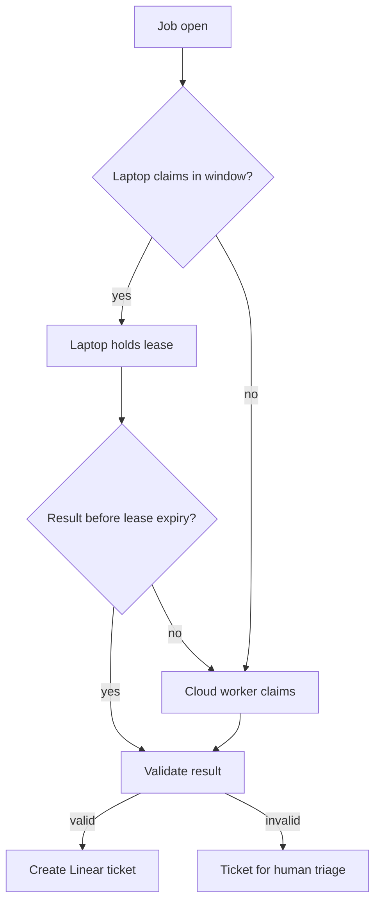
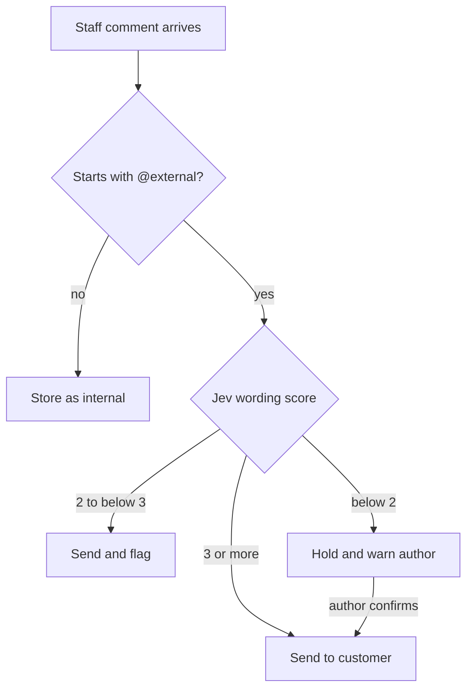
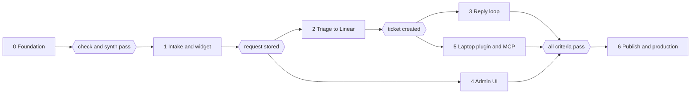

<!-- delivery-loop:goal-prd -->
# PressW Customer Support V1

> A drop-in React support widget sends customer requests to a PressW backend that triages each request into a Linear ticket and carries the reply thread back to the customer.

**Status:** draft · **Owner:** PressW platform lead · **Updated:** 2026-11-20

## Decide This

No open questions. Every question raised in drafting is a Locked Decision, D28 to D36.

## Goal

PressW has no shared intake path for client support requests. V1 gives client developers one React component and gives PressW one backend. Each request lands in Postgres, passes static checks and a Jev injection filter, and becomes a Linear ticket through a sandboxed agent. Staff reply from Linear, and the customer sees the reply in the widget. The V1 data model already carries the event stream, channel keys, and raw judgments that later analytics, Slack, email, and graph extraction need.

## Operating Truths

| # | Claim | Type | Evidence |
| --- | --- | --- | --- |
| T1 | The repository holds only `README.md`, `CLAUDE.md`, and `.delivery/`. | fact | [CLAUDE.md](../../../CLAUDE.md) |
| T2 | The repository is public. | fact | `gh api repos/pressw-llc/pw-customer-support` returns `visibility: public` |
| T3 | Every pipelines package is TypeScript on Bun. No Python runtime exists. | fact | [packages/](https://github.com/pressw-llc/pw-managed-pipelines/tree/main/packages) |
| T4 | The pipeline queue is SQS, one queue per pipeline step. Postgres holds run state. | fact | [sqs.ts:66-79](https://github.com/pressw-llc/pw-managed-pipelines/blob/main/packages/pw-pipeline/src/runtimes/sqs.ts#L66-L79), [schema.ts:22-212](https://github.com/pressw-llc/pw-managed-pipelines/blob/main/packages/pw-pipeline/src/persistence/schema.ts#L22-L212) |
| T5 | The engine sends no `DelaySeconds`, enforces no retry or backoff, and has no job claim. | fact | [sqs.ts:42-46](https://github.com/pressw-llc/pw-managed-pipelines/blob/main/packages/pw-pipeline/src/runtimes/sqs.ts#L42-L46), [types.ts:49](https://github.com/pressw-llc/pw-managed-pipelines/blob/main/packages/pw-pipeline/src/types.ts#L49) |
| T6 | A managed agent runs in an Anthropic cloud environment. Networking defaults to unrestricted. | fact | [create.ts:25-28](https://github.com/pressw-llc/pw-managed-pipelines/blob/main/packages/pw-managed-agents/src/core/environments/create.ts#L25-L28) |
| T7 | A managed-agent step runs only on Fargate. The validator rejects it on Lambda. | fact | [pw-pipeline README](https://github.com/pressw-llc/pw-managed-pipelines/blob/main/packages/pw-pipeline/README.md) |
| T8 | The pipelines repository ships local infra only. No CDK or CloudFormation exists there. | fact | [infra/](https://github.com/pressw-llc/pw-managed-pipelines/tree/main/infra), [07-roadmap.md](https://github.com/pressw-llc/pw-managed-pipelines/blob/main/docs/packages-intro/concepts/07-roadmap.md) |
| T9 | `bunx pw-pipeline skills install` and `bunx pw-managed-agents skills install` copy authoring skills into `.claude/skills/`. | fact | [skills-install.ts:12-88](https://github.com/pressw-llc/pw-managed-pipelines/blob/main/packages/pw-pipeline/src/cli/commands/skills-install.ts#L12-L88) |
| T10 | `pr-automation` holds working Jev, Linear, and Slack clients and a FIFO queue with a DLQ. | fact | [jev.ts](https://github.com/pressw-llc/pr-automation/blob/main/src/jev.ts), [tickets.ts](https://github.com/pressw-llc/pr-automation/blob/main/src/tickets.ts), [service.yml](https://github.com/pressw-llc/pr-automation/blob/main/infra/aws/service.yml) |
| T11 | The PressW PR reviewer is the `pressw-agent` GitHub App. The App already reviews this repository. | fact | [PR #1](https://github.com/pressw-llc/pw-customer-support/pull/1) carries a `pressw-agent` approval |
| T12 | CodeRabbit reviews this repository today. `pr-automation` disables it with `.coderabbit.yaml`. | fact | [PR #1](https://github.com/pressw-llc/pw-customer-support/pull/1), [.coderabbit.yaml](https://github.com/pressw-llc/pr-automation/blob/main/.coderabbit.yaml) |
| T13 | unpkg and jsDelivr serve only the public npmjs registry. | inference | derived from both CDNs' documented npm source |
| T14 | A Claude artifact can load the widget bundle from a CDN and call the PressW API. | assumption | not verified: needs the bundle on a public CDN and a public API.  |
| T15 | Lambda pipeline steps run under LocalStack or the in-process runner for local development. | fact | The `linear-outbound` handler runs behind an SQS poller against LocalStack SQS. See [pipelines.test.ts](../../../pipelines/pipelines.test.ts). `bun run validate:deploy` also deploys the step into LocalStack Lambda with an SQS event source mapping that reports batch item failures, and a request reaches the Linear stub through it. LocalStack 3 lacks `nodejs22.x`, so the rehearsal runs the same bundle on `nodejs20.x`. |
| T16 | The pipeline schema defaults its tenant column to a client-flavored literal. | fact | [schema.ts:86](https://github.com/pressw-llc/pw-managed-pipelines/blob/main/packages/pw-pipeline/src/persistence/schema.ts#L86) |

## Scope

- React widget: submit a request with text and attachments, list past requests, read and reply in a thread, show an unread indicator.
- Intake API: identity by project key and hashed email, attachment upload, static checks, append-only event stream.
- Triage: claim window with delay and backoff, Jev injection filter, sandboxed managed agent, Linear ticket creation.
- Reply loop on one channel: Linear comments in, customer messages out to Linear.
- Laptop triage: Claude Code plugin, MCP service, channel subscriptions, job claim.
- Admin UI: Cognito login, request list and detail, acknowledgement timer, settings for projects, keys, and integrations.
- CDK stack, Docker Compose local stack, local CI scripts that GitHub Actions also runs.
- Claude skills at `.claude/skills` and `modules/*/.claude/skills`.

## Non-Goals

- **Slack, email, and Claude Code reply channels.** The channel adapter contract ships in V1. Only the Linear adapter ships.
- **Severe-request CC list and per-engineer DM.** Both depend on the Slack adapter.
- **Ontology, themes, sentiment, and emotion views.** V1 stores raw judgments. V2 builds the views.
- **Knowledge graph extraction.** V2 builds the graph in Postgres from the V1 event stream.
- **A Python package.** D1 makes the backend TypeScript.
- **Video attachments.** D33 rejects video.
- **Real-time push to the widget.** V1 polls.
- **End-user authentication.** The hashed ID is the only customer gate.

## Users / Consumers

| Consumer | Use |
| --- | --- |
| Client developer | Installs the widget with a project key and a user email |
| Customer | Submits requests, reads replies, sends follow-ups |
| PressW engineer | Replies in Linear, claims triage jobs from a laptop, queries state over MCP |
| PressW admin | Views requests, manages projects, keys, and integrations |
| Triage worker | Consumes triage jobs, runs the agent, emits results |
| Channel adapter | Reacts to stream events, syncs one external channel |
| V2 analytics | Reads the event stream and raw Jev judgments |

## Locked Decisions

| ID | Decision | Consequence |
| --- | --- | --- |
| D1 | The whole backend runs on TypeScript and Bun. | One runtime with the pipelines packages. No Python code in V1. |
| D2 | The repository is a Bun workspace with modules under `modules/*`. | Modules: `contracts`, `db`, `api`, `widget`, `admin`, `triage`, `channels`, `plugin`, `infra`. Each owns its `.claude/skills`. |
| D3 | A module imports another module only through `contracts` or a package entrypoint. | A lint rule enforces the boundary. |
| D4 | PressW mints one key per client project. The widget sends the key and `SHA-256(email + key)`. | No client backend work. Knowing a user's email and the key grants that user's threads. |
| D5 | The widget renders in a Shadow DOM with bundled styles and React 18 or later as a peer. | No Tailwind or CSS requirement on the host. Host styles cannot break the widget. |
| D6 | The widget publishes to npmjs and GitHub Packages from one release script. | CDN and artifact installs work. Releases need two tokens. |
| D7 | The API persists every inbound request and an event row before any processing. | No request loss on a downstream failure. |
| D8 | Every state change appends a typed event to one Postgres stream table. | Channel adapters, the admin timeline, and V2 analytics read one source. |
| D9 | Static checks run before triage: size caps, type allowlist by magic bytes, markup stripping. | A failing attachment is rejected. A failing message is stored and flagged. |
| D10 | A Jev judgment scores each request for injection intent before the agent runs. | A flagged request skips the agent and becomes a Linear ticket labeled for human triage. |
| D11 | The triage agent has no tools, no MCP servers, and restricted networking. Output is schema-validated JSON. | The agent cannot act. Invalid output takes the D10 fallback path. |
| D12 | Deterministic code, not the agent, calls Linear. Agent output fills enum and length-bounded fields. | Customer text reaches Linear only as quoted content. |
| D13 | A triage job is a Postgres row claimed by one atomic update. SQS carries a delayed wake message for the cloud worker. | Exactly one claimant wins. The engine needs no claim support. |
| D14 | The cloud delay starts at 60 seconds per channel. An unclaimed window halves the delay to zero. A laptop claim resets it to 60. | Idle channels triage instantly. Active engineers get first claim. |
| D15 | A claim carries a lease. An expired lease reopens the job for the cloud worker at once. | A closed laptop cannot strand a request. |
| D16 | A channel key is `client[:project[:user]]`. A subscription matches by prefix. | `acme` receives every `acme` job. A three-part key receives one user's jobs. |
| D17 | Laptop and cloud claimants submit the same result schema through the same validation. | A laptop result gets no extra trust. |
| D18 | Channel adapters run as Lambda pipeline steps triggered by stream events. | Slack and email arrive later as new adapters with no core change. |
| D19 | A staff comment is internal unless it starts with `@external`. A marked comment gets a Jev wording score from 0 to 5. | No unmarked comment reaches a customer. D31 sets the score bands. |
| D20 | Every message stores its origin channel, author, and audience. | The thread shows where each party replied. |
| D21 | Admin settings store integration keys in AWS Secrets Manager. Postgres stores a reference only. | No secret in a database dump, a log, or an API response. |
| D22 | AWS CDK defines the stack. Docker Compose runs Postgres and LocalStack locally. | The same containers and scripts run locally and in AWS. |
| D23 | CI is a set of local scripts. GitHub Actions calls the same scripts and nothing else. | A green local run predicts a green Actions run. |
| D24 | `.coderabbit.yaml` disables CodeRabbit. The `pressw-agent` reviewer and the delivery loop gate every PR. | One automated reviewer. |
| D25 | The gist supplies only: conventional commits, githooks, `.env.example`, `/health`, UUID keys, 85 percent coverage. | Bun, Biome, shadcn, and AWS replace pnpm, ESLint, NiceGUI, and GKE. |
| D26 | Admin is a Vite React app with shadcn and Tailwind, behind Cognito. | Admin API routes reject any request without a valid Cognito token. |
| D27 | The MCP service is an authenticated API route. The plugin authenticates with Cognito. | Subscriptions and queries follow the engineer's identity. |
| D28 | The stack deploys to a new dedicated AWS account in `us-east-1`. | The account, CDK bootstrap, and a GitHub OIDC role must exist before the first deploy. |
| D29 | The widget package is `@pressw-llc/support-react` on npmjs and GitHub Packages. | One name everywhere. PressW needs a `pressw-llc` organization on npmjs. |
| D30 | Admin and MCP login use the `pw-telemetry-platform` Cognito pool through a new app client. | Staff keep one login. The stack validates tokens across accounts and depends on that pool. |
| D31 | A wording score below 2 holds the reply until the author confirms. A score from 2 to below 3 sends and raises a flag. A score of 3 or more sends. | A held reply warns the author in the source channel. A flag shows in the admin UI. |
| D32 | The agent receives request text, images, and text extracted from documents. Deterministic code extracts the text. | Extracted text and image content pass the D10 filter where Jev can read them. D11 still holds. |
| D33 | A message accepts 10 files of 25 MB each: images, PDF, text, logs, CSV, JSON, Office documents, zip. | Video is rejected. Zip content is stored and never extracted for the agent. |
| D34 | A laptop runs a claimed job in a headless Claude Code subagent whose one tool submits the result. | Triage does not interrupt the engineer's session. |
| D35 | Admin settings map each client project to one Linear team. The agent picks labels and priority only. | Team routing is deterministic. |
| D37 | Phases 0 to 5 exit on the local stack. The first AWS deploy happens in Phase 6, after the account exists. | No phase before 6 waits on the account. Every phase keeps `cdk synth` green so the deploy stays ready. |
| D36 | Admin settings store the severe-request CC list in V1. No V1 code reads the list. | The V2 Slack adapter needs no migration. |

Claim precedence for one triage job, per D13 to D15:

Outbound gate for one staff comment, per D19:

## Safety Laws

- Never give customer content to an LLM that holds a tool or open network access.
- Never let model output call an external system. Only deterministic code writes to Linear or to a customer.
- Never send a staff comment to a customer without the `@external` marker.
- Never return one project's data to a request that carries another project's key.
- Never write an integration secret to Postgres, a log, an event, or an API response.
- Never process a request before the request and its event are committed.
- Never commit a client name, client data, or a real project key to this public repository.

## Acceptance Criteria

| ID | Observable behavior or artifact | Proves |
| --- | --- | --- |
| A1 | A fresh React app renders the widget from one import and two props. The host needs no CSS or build change. | D4, D5 |
| A2 | A request with text and two attachments returns success. Postgres holds the request, the files' records, and a `request.created` event. | D7, D8 |
| A3 | A stopped triage worker does not lose a submitted request. Triage completes after the worker restarts. | D7, Safety Law: commit before processing |
| A4 | A renamed executable upload is rejected. A 26 MB file, an eleventh file, and a video are each rejected. | D9, D33 |
| A5 | A request with a known injection payload produces a human-triage ticket. No agent session starts. | D10 |
| A6 | Malformed agent output produces a human-triage ticket. | D11 |
| A7 | The agent definition lists zero tools and zero MCP servers. The environment config restricts networking. | D11, Safety Law: no tools or network |
| A8 | A normal request produces one Linear ticket in the project's configured team, with no manual step. | D12, D35 |
| A9 | Two concurrent claims on one job yield one winner and one refusal. | D13 |
| A10 | With no subscriber, three consecutive jobs on one channel wait 60, 30, then 15 seconds. A laptop claim returns the wait to 60. | D14 |
| A11 | A laptop claims a job and submits nothing. The cloud worker completes the job after lease expiry. | D15 |
| A12 | A subscriber on `acme` receives a job keyed `acme:p:u`. A subscriber on `acme:other` does not. | D16 |
| A13 | A schema-invalid laptop result is refused and the job reopens. | D17 |
| A14 | An unmarked Linear comment never appears in the widget. An `@external` comment appears and raises the unread indicator. | D19, Safety Law: `@external` marker |
| A15 | An `@external` comment scored below 2 stays held until the author confirms. A comment scored 2.5 sends and shows a flag in the admin UI. | D31 |
| A16 | A customer follow-up in the widget appears as a comment on the Linear ticket. | D18, D20 |
| A17 | A request made with project key A and a hashed ID from project B returns no data. | Safety Law: project isolation |
| A18 | A saved Linear key appears in Secrets Manager. A database dump and the settings API response hold no key material. | D21 |
| A19 | An admin route returns 401 without a Cognito token. A telemetry-pool user sees the request list with an acknowledgement timer. | D26, D30 |
| A20 | The plugin lists, adds, and removes subscriptions and queries request state over MCP. | D27 |
| A21 | `bun run check` passes locally. The Actions log shows the same command. | D23 |
| A22 | The stack deploys to the dedicated account from the local deploy script and from Actions. A request submitted to the deployed API reaches Linear. | D22, D28, D37 |
| A23 | `bun install @pressw-llc/support-react` resolves from npmjs and from GitHub Packages. | D6, D29 |
| A24 | A PR in this repository receives a `pressw-agent` review and no CodeRabbit review. | D24 |
| A25 | A lint run fails on a cross-module deep import. | D3 |
| A26 | Each module directory holds at least one skill. The root holds the pipelines skills and a repository skill. | D2 |
| A27 | A request with a screenshot and a PDF yields a ticket summary that cites content from both. A PDF that holds an injection payload yields a human-triage ticket. | D32, D10 |
| A28 | A laptop job completes while the engineer's session shows no prompt. The subagent's tool list holds one tool. | D34 |
| A29 | A saved CC list survives a reload of admin settings. | D36 |

D1, D25 are structural and carry no behavior of their own. A21 and A25 cover them.

## Phased Plan

| Phase | Delivers | Exit | Gate |
| --- | --- | --- | --- |
| 0 | Workspace, `contracts`, `db`, Compose stack, check scripts, Actions, CDK skeleton, `.coderabbit.yaml`, root skills | A21, A24, A25 pass. `cdk synth` passes locally. | PR reviewer |
| 1 | Intake API, attachments, static checks, event stream, widget, example host app | A1 to A4 and A17 pass on the local stack. T14 is verified or recorded as unsupported. | PR reviewer, live validation |
| 2 | Job table, claim protocol, delay and backoff, Jev filter, managed agent, Linear adapter outbound | A5 to A11 and A27 pass against a Linear sandbox team. T15 is verified. | Adversarial review, live validation |
| 3 | Linear webhook inbound, marker and wording gate, customer follow-up sync, unread indicator | A14 to A16 pass. | Adversarial review, live validation |
| 4 | Cognito login, request list and detail, acknowledgement timer, settings, secret storage | A18, A19, and A29 pass. | PR reviewer, live validation |
| 5 | MCP route, subscriptions, Claude Code plugin, laptop claim and result | A12, A13, A20, and A28 pass with a real laptop session. | Adversarial review, live validation |
| 6 | Release script for both registries, production deploy, runbook | A22, A23, A26 pass on AWS. | Owner approval |

Each phase ships the skills for the modules it creates. Phases 2 to 5 seed settings from a script until Phase 4 lands the settings UI.

Owner actions that gate a phase exit:

| Action | Gates |
| --- | --- |
| Create the dedicated AWS account and grant deploy access. The account is pending. | Phase 6 |
| Grant an app client on the telemetry Cognito pool | Phase 4 |
| Provide a Linear sandbox team and API key, a Jev key, and Anthropic access | Phase 2 |
| Create the `pressw-llc` npmjs organization and a publish token | Phase 6 |

## Validation Plan

- Unit tests per module with `bun test`, with an 85 percent coverage floor in the check script.
- Integration tests run against the Compose stack: real Postgres, LocalStack SQS and S3. No in-memory fakes of owned infrastructure.
- Live validation per phase against real Jev, real Managed Agents, and a Linear sandbox team.
- An injection corpus of known payloads runs in CI against the Jev filter and reports the flag rate.
- A concurrency test fires parallel claims at one job for A9.
- A deployed smoke test submits one request to the AWS stack and reads back the Linear ticket.
- Cleanup: each live run archives its Linear tickets and deletes its test project.

## Risks

| Risk | Mitigation |
| --- | --- |
| A Claude artifact blocks the widget or its API calls. | T14 is tested in Phase 1. The owner decided that a failure records artifacts as unsupported and V1 continues. |
| The Jev filter misses a novel injection. | D11 and D12 hold without the filter. The agent cannot act and cannot write. |
| A pipelines release changes behavior. | Pin exact versions. The claim protocol in D13 lives in this repository. |
| The pipeline tenant default from T16 lands in this stack's tables. | Set the tenant explicitly on every run. File an upstream issue to remove the literal. |
| A public intake endpoint draws abuse. | Rate limit per project key and per hashed ID. Attachment caps from D33. |
| An image or document carries injected instructions to the agent. | D32 filters extracted text. D11 and D12 leave the agent unable to act or write. |
| The telemetry Cognito pool changes or goes down. | D30 isolates the dependency to one token validator. Admin and MCP fail closed. |
| Lambda steps do not run locally. | T15 is tested in Phase 2. The fallback runs adapters through the in-process runner locally. |
| A laptop receives customer content. | Subscriptions require a Cognito identity from D27. Claims are recorded per engineer. |
| The first deploy in Phase 6 exposes gaps between LocalStack and AWS. | D37 keeps `cdk synth` in the check script. The same containers run in both places under D22. |
| V1 scope is large for a first release. | Phases 4 and 5 run in parallel with 3. Each phase exits on its own criteria. |

## Accepted Risk

- **A person who holds the project key and a user's email can read that user's threads.** The owner accepted minimal identity security because V1 serves only trusted internal clients.
- **The project key is visible in client frontend code.** D4 treats the key as an identifier, not a secret.

## Superseded / Removed

- **Python capture and backend.** The pipelines packages run only on Bun, and the owner chose one runtime.
- **Gist tooling: pnpm, ESLint, NiceGUI, GKE, Helm, Google ADK.** The brief and the workspace rules name Bun, Biome, shadcn, AWS, and PressW managed agents.
- **Pipelines repository as the infra provider.** T8 shows local infra only. This repository owns its CDK stack.
- **Docker sandbox for the agent.** T6 shows the sandbox is an Anthropic cloud environment.
